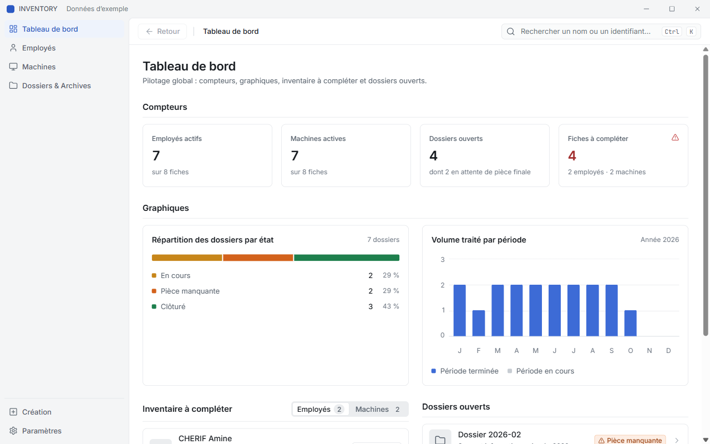
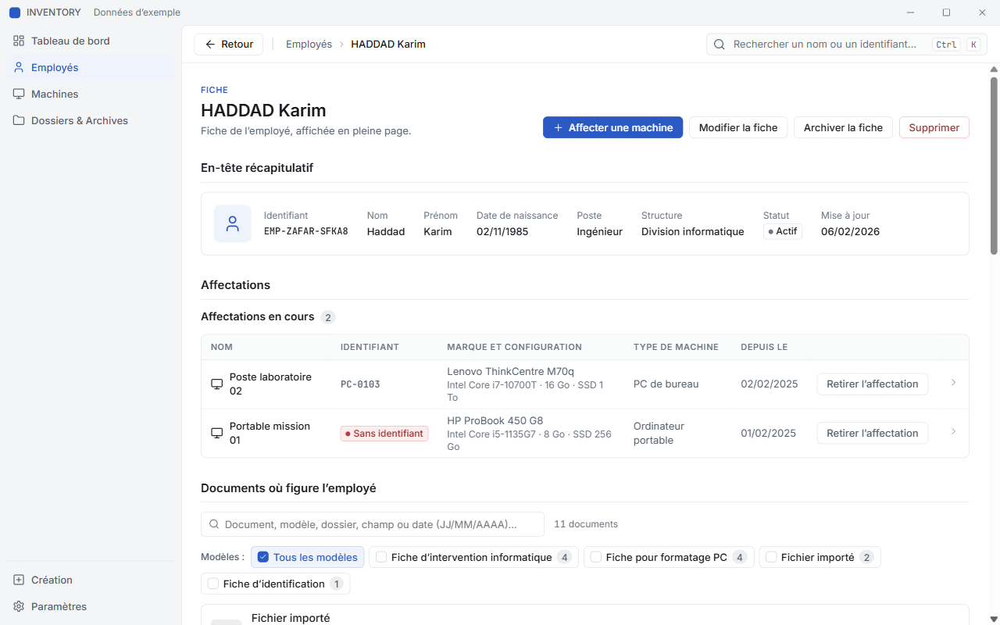
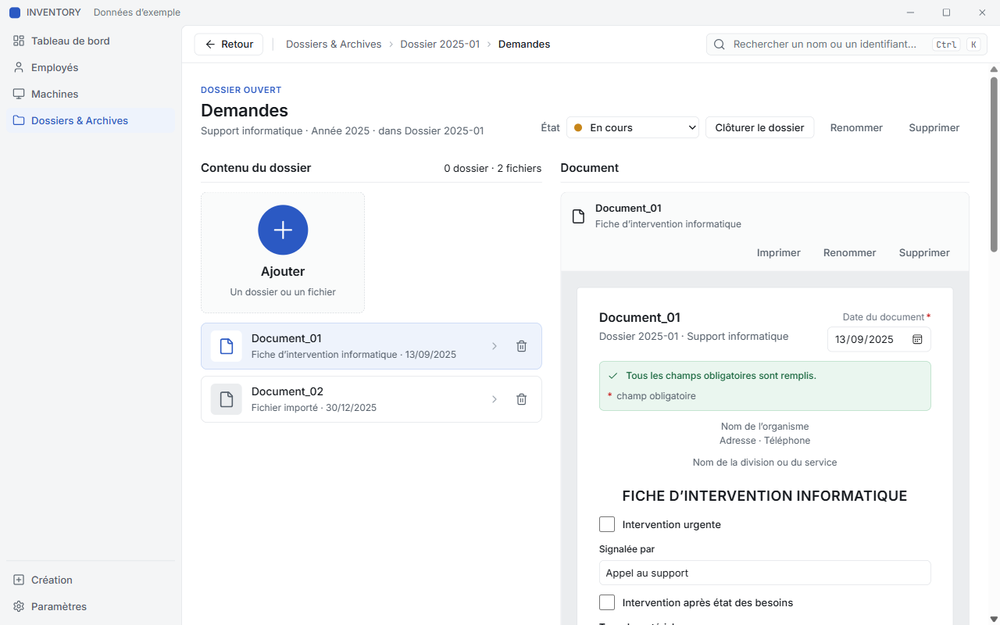
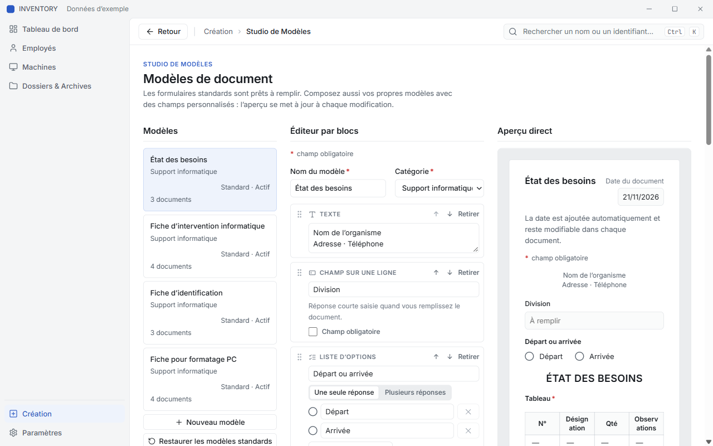
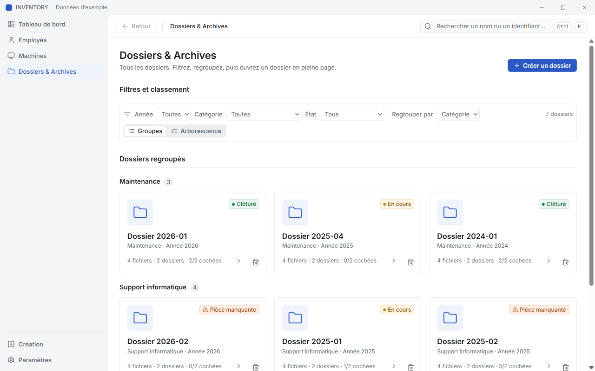
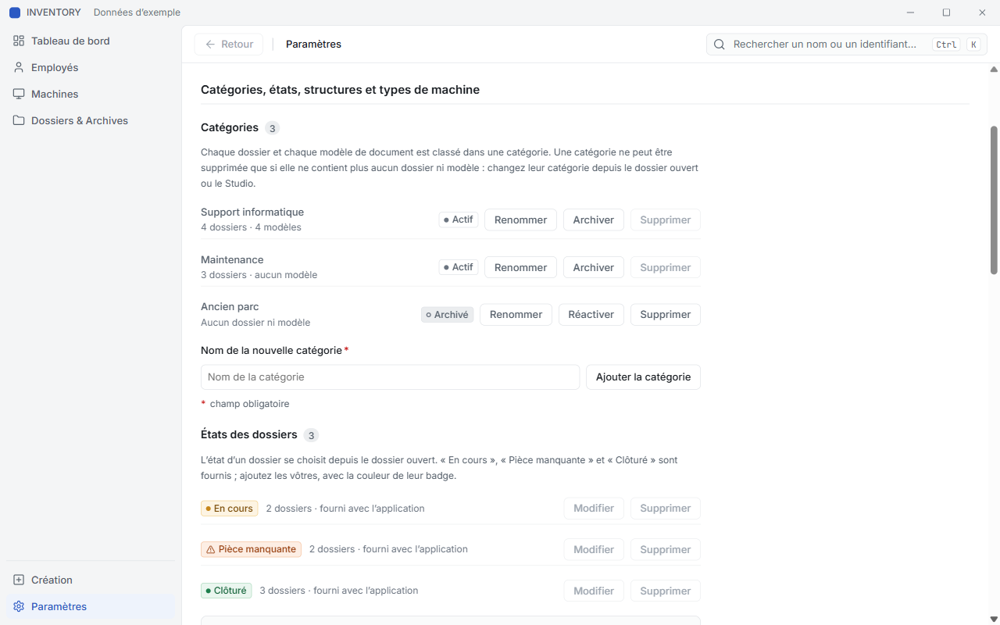
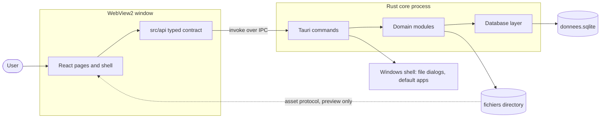

# INVENTORY

[](https://github.com/abderraouf-chekroun/INVENTORY/actions/workflows/ci.yml)
[](LICENSE)


INVENTORY is a Windows desktop application for the IT department of an organisation. It keeps a directory of **employees** and **machines** (desktop PCs and laptops), records which machine is **assigned** to which employee and when, and holds the paperwork around them: **dossiers** (case folders with sub-folders), **documents** filled in on screen from form templates, and **imported files**. Everything runs and is stored locally: there is no server, no account, no telemetry and no network access at run time. The application is distributed as a single per-user installer.

> The user interface, the code identifiers and the code comments are in **French**. This documentation is in English; the detailed functional specification ([`docs/specification.md`](docs/specification.md)) is in French.

Current version: **1.8.2**. See [`CHANGELOG.md`](CHANGELOG.md).

## Contents

- [Screenshots](#screenshots)
- [Features](#features)
- [Architecture at a glance](#architecture-at-a-glance)
- [Technology stack](#technology-stack)
- [Installing (users)](#installing-users)
- [Where the data lives](#where-the-data-lives)
- [Building from source](#building-from-source)
- [Testing](#testing)
- [Repository layout](#repository-layout)
- [Security](#security)
- [Documentation](#documentation)
- [Licence](#licence)

## Screenshots

All data shown is fictitious (the built-in example data set). The screenshots are produced by `npm run captures` from the production executable, in a temporary data directory.

Each image opens at full size when clicked; if an image cannot be loaded, its description is shown in its place.

| Dashboard | Employee record |
| --- | --- |
| [](docs/images/dashboard.png) | [](docs/images/employee.png) |
| **Open dossier** | **Template studio** |
| [](docs/images/dossier.png) | [](docs/images/studio.png) |
| **Dossiers and archives** | **Settings** |
| [](docs/images/archives.png) | [](docs/images/settings.png) |

## Features

- **Employees.** Last name, first name, date of birth, job title and structure (organisational unit). Each complete record receives a generated identifier of the form `EMP-XXXXX-XXXXX`, computed with HMAC-SHA-256 and a secret key drawn at random for each database: it cannot be guessed and reveals nothing about the person. Incomplete records are listed as "to complete".
- **Machines.** Name, free-form identifier (unique, case-insensitive), brand and model, processor, RAM, storage and machine type.
- **Assignments.** A machine is assigned to an employee for a period; current and past assignments are kept with their dates and can be managed from either record. Ending an assignment is always possible.
- **Dossiers.** Name, year, category and status; nested sub-folders; a checklist per dossier. Three built-in statuses ("En cours", "Pièce manquante", "Clôturé") plus user-defined statuses with a colour from a fixed palette of nine. A dossier whose status is "Pièce manquante" (missing document) cannot be closed; a closed dossier is read-only until reopened.
- **Documents from templates.** Templates are built in a studio from **13 block types** (title, paragraph, single-line and multi-line fields, date, checkbox, choice list, table, keyword, computed variable, employee, machine, signature). A document takes a snapshot of its template, is saved automatically while typing, can be printed, and shows how many mandatory fields are still empty. Signatures are dated "Signed" checkboxes.
- **Four standard templates** ship with the application and are always available: "État des besoins" (needs statement), "Fiche d'intervention informatique" (IT intervention form), "Fiche d'identification" (assignment of a professional mailbox) and "Fiche pour formatage PC" (PC reformatting form). Their headers are neutral placeholders that you adapt in the studio.
- **Imported files.** Any file of up to 200 MB can be attached to a dossier through the Windows "Open" dialog. Real PDFs and images (PNG, JPEG, GIF, WebP, BMP) are previewed inside the application, as decided by the file's content rather than its name; common document types (PDF, images, text, office documents, e-mails) can be opened with the default Windows application; anything else (programs, scripts, web pages, shortcuts…) is stored under a neutral `.bin` extension and can still be retrieved unchanged with "Enregistrer une copie…". Every copy carries the Windows "downloaded from the Internet" mark, so Office opens it in Protected View.
- **Mentions.** An employee or a machine is *mentioned* in a document when an employee or machine block designates it, or when its name (employee) or identifier (machine) is written in a field. Mentions are stored with the field and the time they appeared, and each record's profile lists the documents and dossiers where it is mentioned, with a searchable history.
- **Global search** (Ctrl+K) over employees, machines and dossiers, case- and accent-insensitive, up to 50 results per group.
- **Dashboard** with counters, the distribution of dossiers by status, the records to complete and the number of documents added per month in the current year.
- **Reference lists.** Categories (for dossiers and templates), structures, machine types and the keyword list used by keyword blocks can be renamed, archived and deleted, under rules that never lose data.
- **Deletion rules.** Documents, employees, machines, dossiers and unused templates can be deleted after a confirmation that shows the real numbers involved. Text is preserved: documents keep the name of a deleted employee or machine, and the history of other records keeps it as plain text.
- **Automatic backups** before every data reset and before every database upgrade.
- **Fully offline.** No network request at run time: no CDN, no telemetry, no automatic update. Fonts are bundled.
- **Display options**: system, light or dark theme; standard or compact density.

## Architecture at a glance

INVENTORY is a [Tauri 2](https://tauri.app) application: a Rust core process owns the database and the file system, and a React interface runs in the Windows WebView2 control. The interface talks to the core only through a typed contract of 68 commands.



The full technical description, with diagrams of every layer, is in [`docs/ARCHITECTURE.md`](docs/ARCHITECTURE.md).

## Technology stack

Versions are those pinned in `package-lock.json` and `src-tauri/Cargo.lock`.

| Layer | Technology |
| --- | --- |
| Desktop shell | Tauri 2.12 (Rust, edition 2024), WebView2 on Windows |
| Tauri plugins | `dialog` (native file dialogs), `opener` (default application), `single-instance` |
| Database | SQLite through `rusqlite` 0.43 with the `bundled` feature (compiled into the executable, no DLL) |
| Cryptography | `hmac` 0.12 and `sha2` 0.10 (employee identifiers), `getrandom` (key generation) |
| User interface | React 19.3, TypeScript 6.0 (strict), Vite 8.3 |
| UI state | `@tanstack/react-query` 5 (server data cache), `zustand` 5 (navigation and view state) |
| Fonts | `@fontsource/inter`, `@fontsource/jetbrains-mono` (bundled) |
| Tests | Rust `cargo test`, Vitest 5, Playwright Core 1.65 (end-to-end over the WebView2 debugging protocol) |
| Installer | NSIS, built by the Tauri bundler, per-user, French |

## Installing (users)

**Requirements**

- Windows 11, 64-bit.
- The Microsoft Edge WebView2 Runtime, which is part of Windows 11. The installer does **not** download it: on a machine where WebView2 is missing, the application does not start.

**Getting the installer**

The installer is not stored in this repository. It is attached to each [GitHub release](../../releases) as `INVENTORY_<version>_x64-setup.exe`, next to a `INVENTORY_<version>_x64-setup.exe.sha256` file. You can also [build it yourself](#building-from-source).

**Verify the installer before running it.** The installer is not code-signed, so its SHA-256 fingerprint is the only proof that it has not been altered. Compute it and compare it with the content of the `.sha256` file, ideally obtained through a different channel than the installer itself:

```powershell
Get-FileHash -Algorithm SHA256 -LiteralPath ".\INVENTORY_1.8.2_x64-setup.exe"
Get-Content -LiteralPath ".\INVENTORY_1.8.2_x64-setup.exe.sha256"
```

If the two values differ, do not install. If they match, Windows SmartScreen may still warn that it "protected your PC", because the installer is not signed.

**Installing**

- The installation is per user and does not require administrator rights. Keep the proposed folder, `%LOCALAPPDATA%\INVENTORY`: only your account can write to it. If you choose a folder outside your profile, the installer restricts its permissions to your account, SYSTEM and the Administrators group.
- A new version installs over the previous one and keeps all data.
- Versions up to 1.4.0 were called "Entités et Dossiers". The installer detects such an installation and removes its program files, shortcuts and registry entries without running its uninstaller and without touching the data folder; if the old application is running, it asks you to close it. The data directory did not change, so INVENTORY finds the existing data as it is.

**Upgrading from an older version**

Install the new version over the old one. On the first start, a database created by version 1.0 to 1.4 is first copied to `sauvegardes\avant-version-N_…` (see [backups](#where-the-data-lives)), then upgraded to the current schema; this backup is never deleted automatically. Nothing is lost:

- dossiers, documents, assignments, templates and imported files are kept, and every dossier keeps its status;
- from 1.0: former "A" records become employees (their name is kept; first name, date of birth and job title are to be completed, and the identifier is assigned once the record is complete); former "B" records become machines that keep their old code as identifier; the four standard templates are added;
- from 1.0 or 1.1: each association between an employee and a machine becomes a current assignment starting on the date of the association, and existing signatures are unsigned;
- from 1.0 to 1.3: the employee and the machine a dossier was attached to are carried into each of its documents (an employee or machine block is added or filled in, also for imported files), and an attached dossier without documents receives one named "Employé et machine du dossier", so every record still sees its documents and dossiers and every document's computed values are unchanged; mentions are dated from each document's creation;
- from 1.0 to 1.2: every complete employee's identifier is recomputed in the form `EMP-XXXXX-XXXXX`, and the former identifier is written to the record's history.

**First launch**

On a new installation the database is empty: no employee, machine, dossier or document, only the four standard templates in the category "Support informatique". To start:

1. create an employee (Employees, "Créer un employé"); if no structure exists yet, the form lets you create the first one in place, and the same applies to the first machine type;
2. create a dossier (Dossiers & Archives, "Créer un dossier");
3. add documents to it from the templates.

To explore the application first, the "Données" section of Settings ("Paramètres") can load a fictitious example data set ("Recharger les données d'exemple"); "Effacer toutes les données" returns to the empty state of the first launch. Both actions are preceded by an automatic backup, and both recreate the four standard templates. In the studio, "Restaurer les modèles standards" recreates any standard template that is no longer available (archived, renamed or deleted) without changing your own templates.

## Where the data lives

Everything is stored on the local machine. The data directory is `%APPDATA%\fr.entitesdossiers.app` (the application identifier dates from the former product name and was kept so that upgrades find existing data):

| Item | Content |
| --- | --- |
| `donnees.sqlite` (with `-wal` and `-shm` while open) | the database: employees, machines, assignments, dossiers, documents, templates, history, preferences |
| `fichiers\` | copies of imported files, named by a random UUID |
| `sauvegardes\` | automatic backups (see below) |
| `journal-erreurs.log` | technical details of errors; the interface only shows a short message |

The WebView2 profile (interface cache and local storage) is kept separately in `%LOCALAPPDATA%\fr.entitesdossiers.app`. The button "Ouvrir le dossier des données" in Settings opens the data directory. To back up the application or move it to another machine, close it and copy the whole data directory. This directory is not covered by OneDrive or File History by default: back it up yourself.

The database and the imported files are **not encrypted**. They are protected by the permissions of your Windows profile: only your account, the system and the machine's administrators can read them, which also means that any program running under your account can. Enable BitLocker on the disk to protect them against theft or loss of the computer.

**Backups**

- Before every reset ("Effacer toutes les données" or "Recharger les données d'exemple"), the database is copied and the `fichiers\` folder is moved into `sauvegardes\YYYY-MM-DD_HH-MM-SS\`. If either step fails, nothing is erased. The three most recent of these backups are always kept, and none younger than seven days is deleted.
- Before a database created by an older version is upgraded, it is copied to `sauvegardes\avant-version-N_YYYY-MM-DD_HH-MM-SS\donnees.sqlite`, where `N` is the first schema version applied (`avant-version-2` for a 1.0 database, up to `avant-version-6` for a 1.4 database). These backups are never deleted automatically.

**Restoring a backup**

1. Close the application.
2. In the data directory, move `donnees.sqlite` (with `donnees.sqlite-wal` and `donnees.sqlite-shm` if present) and the `fichiers\` folder somewhere else.
3. Copy `donnees.sqlite` and `fichiers\` from the chosen `sauvegardes\…` folder in their place (an `avant-version-…` backup contains only `donnees.sqlite`: in that case, put back the `fichiers\` folder moved aside in step 2).
4. Start the application.

**Refused database.** On start-up an existing database is checked read-only before any backup or upgrade (known schema version, integrity, exact schema, no trigger or view, consistent references). A database modified by another tool or damaged is refused **without being modified**: a native message gives the data directory and the steps to follow, with a button to open it, and the details are written to `journal-erreurs.log`. To start again from an empty database, rename `donnees.sqlite` (for example to `donnees-refusee.sqlite`) and start the application, or restore a backup as above.

**Environment variables.** The executable honours `ENTITES_DOSSIERS_DONNEES` (another data directory; an absolute local path, network paths are refused) and the WebView2 variables `WEBVIEW2_USER_DATA_FOLDER` and `WEBVIEW2_ADDITIONAL_BROWSER_ARGUMENTS`. They are used by the end-to-end suite and are not set in normal use; the last one can open a debugging port through which any local program could drive the application. If the application behaves unexpectedly, check that none is set: `Get-ChildItem Env:ENTITES*, Env:WEBVIEW2*`.

**Uninstalling.** Use Windows Settings > Apps. The uninstaller offers to delete the application data; leave that option unchecked to keep the data directory.

## Building from source

**Prerequisites** (Windows 11, x64):

- Node.js and npm (continuous integration uses the major version given in `.nvmrc`);
- a stable Rust toolchain for the `x86_64-pc-windows-msvc` target, recent enough for the 2024 edition and let-chains (Rust 1.88 or newer);
- Visual Studio 2022 Build Tools with the C++ workload and a Windows SDK;
- the WebView2 Runtime (included in Windows 11).

**Commands**

```powershell
npm ci                 # install exactly the versions of package-lock.json
npm run tauri dev      # run the application in development mode (Vite dev server on port 1420)
npm run livrer         # build the hardened release and the installer
```

`npm run livrer` is the only supported way to produce an installer for distribution. It checks that `node_modules` matches `package-lock.json`, builds with locked Rust dependencies, removes build-machine paths from the binary, enables Control Flow Guard and CET compatibility, verifies the executable, and writes the installer and its SHA-256 file to `installateur\` (not versioned):

```
installateur\INVENTORY_1.8.2_x64-setup.exe
installateur\INVENTORY_1.8.2_x64-setup.exe.sha256
```

`npm run tauri build` also works for a quick trial, but without these options and checks. Switching between the two rebuilds all Rust dependencies, because the compiler flags differ. Details: [`scripts/README.md`](scripts/README.md).

## Testing

```powershell
npx tsc --noEmit                      # type-check the front end
npx vitest run                        # front-end unit tests (also: npm test)
cd src-tauri; cargo test --locked     # back-end tests on in-memory and temporary SQLite databases
npm run e2e:build                     # build the release executable, then run the end-to-end suite
npm run e2e                           # run the end-to-end suite on the executable already built
npm run test:installateur             # test the installer's pre-install hook (needs makensis, writes a test registry key)
```

Continuous integration (`.github/workflows/ci.yml`) runs the type-check, the unit tests, the front-end build and the Rust tests, and audits the dependencies, on every push and pull request.

The end-to-end suite starts the real production executable on an isolated, temporary data directory: your own data is never modified. It needs a visible Windows session and **drives the real mouse and keyboard** (drag and drop in the studio, native "Open" and "Save as" dialogs). Close INVENTORY before starting it, do not touch the mouse or keyboard while it runs, and run it only on a machine where you are the only signed-in user, because the WebView2 debugging port is open on `127.0.0.1` during the run. Details and options: [`tests/README.md`](tests/README.md).

## Repository layout

```
.github/workflows/   continuous integration (ci.yml)
design/              original static HTML prototype, icon source
docs/                architecture, specification, front-end conventions, security audit, screenshots
scripts/             production build and delivery scripts
src/                 front end: React + TypeScript
  api/               typed contract with the back end (types and invoke calls)
src-tauri/           back end: Rust core, Tauri configuration, icons, installer hooks
  migrations/        SQLite schema migrations 001 to 006
tests/e2e/           end-to-end suite driving the production executable, screenshot script
tests/installateur/  test of the installer's pre-install hook
```

| Part | README |
| --- | --- |
| Front end | [`src/README.md`](src/README.md) |
| Back end | [`src-tauri/README.md`](src-tauri/README.md) |
| Database migrations | [`src-tauri/migrations/README.md`](src-tauri/migrations/README.md) |
| Tests (end-to-end, installer hook, screenshots) | [`tests/README.md`](tests/README.md) |
| Build and delivery scripts | [`scripts/README.md`](scripts/README.md) |
| Documentation index | [`docs/README.md`](docs/README.md) |

The screens, French labels and CSS classes come from [`design/prototype-entites-dossiers.html`](design/prototype-entites-dossiers.html), the original static HTML prototype the application was built from.

Some internal names come from the former product name "Entités et Dossiers" and are kept on purpose: the application identifier `fr.entitesdossiers.app` (it fixes the data directory), the npm package and Rust crate `entites-dossiers`, and the test-only environment variable `ENTITES_DOSSIERS_DONNEES`.

## Security

The application is local and single-user; the threats it is designed against are a malicious imported file, a tampered database or data folder received from someone else, and hostile script that would run in the interface. The main controls:

- a strict Content Security Policy with no remote origin and no inline script or style;
- the interface is granted only the window and event permissions it uses; file dialogs and file opening run in Rust, so no file path ever comes from the interface;
- the window can only navigate inside the application, new windows and downloads are refused, and every request to another host receives a local 403 response;
- the type of an imported file is decided by its content, only allow-listed types can be opened by Windows, other files are stored with a neutral `.bin` extension, and every copy carries the Windows "downloaded from the Internet" mark;
- an existing database is validated read-only before use, in SQLite defensive mode, and is backed up before any upgrade;
- release builds have Control Flow Guard, high-entropy ASLR, DEP and CET shadow-stack compatibility, carry no build-machine path, and are delivered with a SHA-256 fingerprint;
- continuous integration also audits the Rust and npm production dependencies for known vulnerabilities.

Known limits: the installer is not code-signed, and the data is not encrypted (it is protected by the Windows profile permissions; use BitLocker against theft of the computer).

To report a vulnerability, follow [`SECURITY.md`](SECURITY.md). The security architecture is described in [`docs/ARCHITECTURE.md`](docs/ARCHITECTURE.md#9-security-architecture); the security audit of version 1.0.0 and the security review of version 1.8.2, in French, are in [`docs/audit-securite.md`](docs/audit-securite.md).

## Documentation

| Document | Language | Content |
| --- | --- | --- |
| [`docs/ARCHITECTURE.md`](docs/ARCHITECTURE.md) | English | complete technical description: runtime, contract, modules, data model, security, build, tests, operations |
| [`docs/specification.md`](docs/specification.md) | French | functional specification: data model, business rules, contract, screens, changes per version |
| [`docs/socle-front.md`](docs/socle-front.md) | French | front-end conventions for writing a page |
| [`docs/audit-securite.md`](docs/audit-securite.md) | French | security audit of version 1.0.0 and security review of version 1.8.2 |
| [`CHANGELOG.md`](CHANGELOG.md) | English | changes per version |
| [`CONTRIBUTING.md`](CONTRIBUTING.md) | English | how to contribute |
| [`SECURITY.md`](SECURITY.md) | English | security policy and vulnerability reporting |

## Licence

INVENTORY is free software, distributed under the GNU General Public License, version 3 only (`GPL-3.0-only`). See [`LICENSE`](LICENSE).
