# INVENTORY — Architecture

This document is the technical description of INVENTORY 1.8.2: how the application is built, how it runs, how it stores data, how it is secured, built, delivered and tested. It describes the code as it is in this repository. The functional rules are specified in more detail, in French, in [`specification.md`](specification.md); section numbers such as "§ 10.1" below refer to that document.

## Table of contents

1. [Goals and constraints](#1-goals-and-constraints)
2. [Runtime architecture and process model](#2-runtime-architecture-and-process-model)
3. [The typed contract](#3-the-typed-contract)
4. [Back-end module map](#4-back-end-module-map)
5. [Data model](#5-data-model)
6. [Domain rules with technical impact](#6-domain-rules-with-technical-impact)
7. [File storage](#7-file-storage)
8. [Front-end architecture](#8-front-end-architecture)
9. [Security architecture](#9-security-architecture)
10. [Build, packaging and release](#10-build-packaging-and-release)
11. [Testing strategy](#11-testing-strategy)
12. [Operational notes](#12-operational-notes)
13. [Glossary of French identifiers](#13-glossary-of-french-identifiers)

## 1. Goals and constraints

INVENTORY replaces paper forms and spreadsheets in a small IT department: who works here, which machine each person uses, and which forms were filled in for which person or machine. The design follows from a few fixed constraints:

| Constraint | Consequence in the code |
| --- | --- |
| Runs on a single Windows 11 workstation, for one user | Tauri 2 desktop application with WebView2; per-user NSIS installer; data in the user's profile |
| No network at run time | no CDN (fonts bundled), no telemetry, no update check; the window refuses every request to another host |
| Data must never be lost silently | read-only validation before opening a database; backups before every reset and every schema upgrade; deletions preserve text that other records depend on |
| Untrusted inputs are imported files and databases received from elsewhere | file type decided by content, allow-list for opening, confinement of stored copies, exact schema comparison, SQLite defensive mode |
| French user interface | every label and every error message returned by the back end is in French and can be shown as is |
| Testable without a GUI | all business logic lives in Rust functions that take a `&rusqlite::Connection`, tested on in-memory or temporary databases |

## 2. Runtime architecture and process model

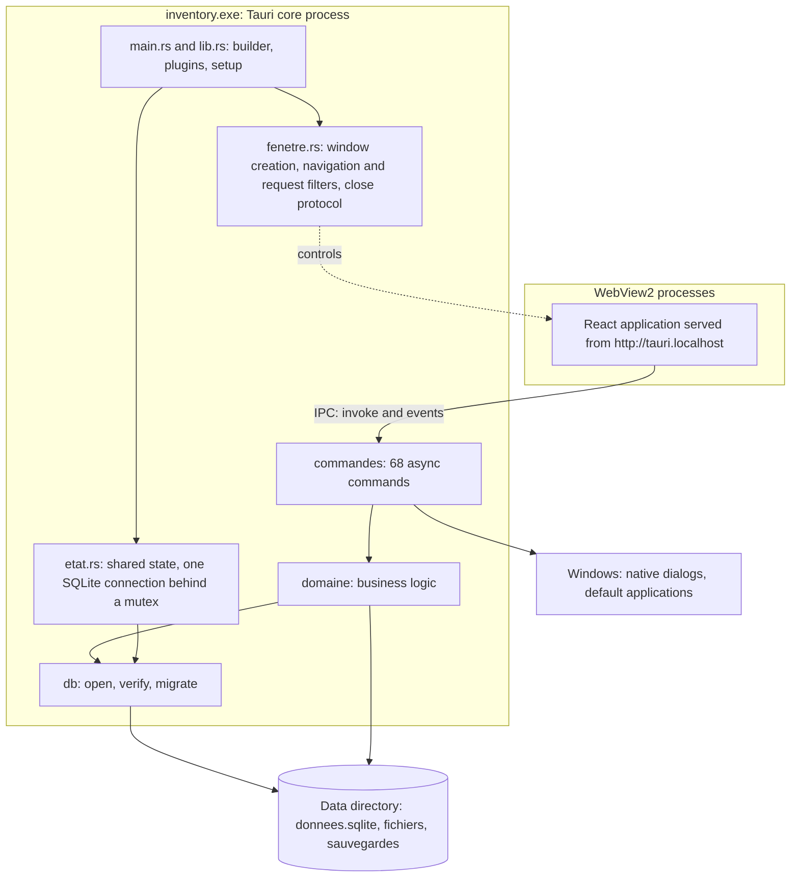

**Processes.** `inventory.exe` hosts the Tauri runtime and all Rust code. The interface runs in WebView2, which Windows starts as separate browser processes. In a release build the interface is served by Tauri from the embedded `dist/` bundle at the origin `http://tauri.localhost`; IPC calls go to `http://ipc.localhost`, and previews of imported files to `http://asset.localhost`.

**Start-up** (`src-tauri/src/lib.rs`):

1. The `single-instance` plugin is registered first: starting the application again brings the existing window to the front instead of opening a second instance.
2. The `opener` and `dialog` plugins are registered for use **from Rust only**; the interface has no permission on them.
3. `setup` resolves the data directory (`etat::dossier_donnees`), opens the database (`Etat::ouvrir_dans`, see [5.4](#54-opening-a-database)), allows the asset protocol on the `fichiers` directory only, stores the state, and creates the window.
4. If any of this fails, no window is created: a native error dialog explains the reason, shows the data directory and offers to open it, then the process exits with code 1.

**Window** (`src-tauri/src/fenetre.rs`). The window is declared in `tauri.conf.json` with `create: false` and is built by code, so that filters can be attached before the page loads:

- top-level navigation is allowed only to the application's own origin (and to the Vite development URL in debug builds);
- new windows are denied and downloads are refused;
- on Windows, a `WebResourceRequested` handler answers every request to a host other than `tauri.localhost`, `ipc.localhost` or `asset.localhost` with a local `403`, so nothing leaves the machine;
- the window has no native decorations (`decorations: false`): the React title bar is the real one, with a drag region (`data-tauri-drag-region`) and minimise, maximise/restore and close buttons;
- `dragDropEnabled: false`, so that HTML5 drag and drop works inside the template studio; files dropped on the window are neutralised by the front end (`src/lib/depot.ts`).

**Close protocol.** Closing is driven by Rust so that it always completes, even if the interface is frozen:

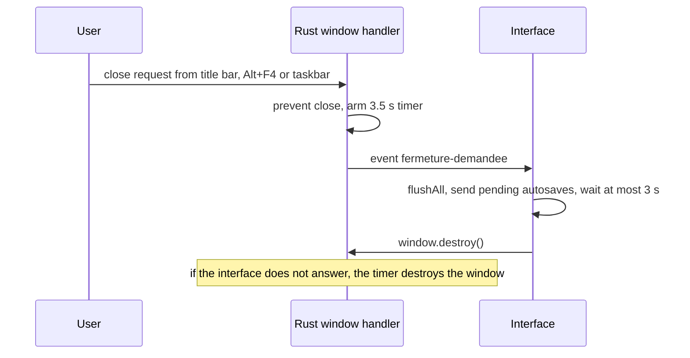

A second close request during the delay is ignored (`GardeFermeture`), so a double click on the close button cannot lose the last edit.

**Concurrency.** Every command is `async` and runs on Tauri's async runtime, off the UI thread. The single `rusqlite::Connection` is held in a `Mutex` inside `Etat`; each command locks it for the duration of its database work, so database access is serialised. Blocking work that does not need the database (native file dialogs, copying an imported file) runs in `spawn_blocking` outside the lock. A poisoned mutex (a command that panicked) is recovered rather than making the application unusable.

## 3. The typed contract

Pages never call `invoke` themselves: the only calls to application commands are in `src/api/index.ts` (window controls and event listening use the `@tauri-apps/api` window and event modules). `src/api/index.ts` exports one object, `api`, whose 68 functions map one-to-one to the 68 Tauri commands registered in `lib.rs`; `src/api/types.ts` declares every type exchanged.

| Convention | Rule |
| --- | --- |
| Command names | the TypeScript function `entiteCreer` calls the Rust command `entite_creer` (camelCase to snake_case) |
| Arguments | passed as an object with camelCase keys (`{ dossierId, sousDossierId }`); Tauri maps them to snake_case Rust parameters |
| Results | Rust structures are serialised with `#[serde(rename_all = "camelCase")]` |
| Errors | every command returns `Result<T, AppError>`; `AppError` serialises to `{ code, message }` |
| Dates | text in local time: `YYYY-MM-DD HH:MM:SS` for timestamps, `YYYY-MM-DD` for document dates |

Commands by area (counted from `generate_handler!` in `src-tauri/src/lib.rs`):

| Area | Commands | Examples |
| --- | --- | --- |
| Settings and system | 5 | `parametres_lire`, `infos_systeme`, `donnees_reinitialiser` |
| Reference lists | 15 | `theme_*`, `categorie_*`, `magasin_*` (list, create, archive, rename, delete) |
| Employees, machines, assignments | 12 | `entite_creer`, `identifiant_employe_apercu`, `entite_supprimer`, `association_creer` |
| Dossiers, statuses, sub-folders, checklist | 19 | `dossier_definir_statut`, `statut_creer`, `sous_dossier_supprimer`, `option_cocher` |
| Documents | 8 | `document_importer`, `document_enregistrer_blocs`, `document_exporter` |
| Templates | 7 | `modele_enregistrer`, `modele_supprimer`, `modeles_standards_restaurer` |
| Search and dashboard | 2 | `recherche`, `tableau_de_bord` |

**Error model** (`src-tauri/src/error.rs`). `code` is a stable machine-readable string; `message` is a French sentence that the interface displays unchanged. Technical details (paths, SQLite or OS messages) never reach the interface: conversions from `rusqlite::Error`, `std::io::Error`, `serde_json::Error` and `tauri::Error` write the detail to `journal-erreurs.log` and return a generic message. The log is rotated to `journal-erreurs.log.1` above 1 MiB.

| Code | Meaning |
| --- | --- |
| `saisie_invalide` | invalid input (empty required name, value too long, unknown option) |
| `introuvable` | the requested row does not exist |
| `dossier_clos` | the dossier is closed, hence read-only |
| `doublon`, `code_doublon` | a name or identifier already used |
| `categorie_utilisee`, `statut_fourni`, `transition_interdite`, `theme_archive`, `modele_archive` | refused by a business rule |
| `fichier_ouvert`, `fichier_trop_volumineux`, `source_refusee`, `destination_refusee` | file operations refused |
| `base_refusee`, `migration_impossible`, `dossier_donnees_refuse` | start-up refusals |
| `base_de_donnees`, `fichier`, `donnees_illisibles`, `interne` | technical failures (detail in the log) |

On the TypeScript side `versApiError` normalises any rejection into `{ code, message }`.

## 4. Back-end module map

All paths are relative to `src-tauri/src/`.

| Module | Responsibility |
| --- | --- |
| `main.rs` | entry point; hides the console window in release builds |
| `lib.rs` | Tauri builder, plugins, `setup`, registration of the 68 commands, configuration guard tests |
| `etat.rs` | data-directory resolution (including `ENTITES_DOSSIERS_DONNEES`), `Etat` (connection, paths), start-up failure message |
| `fenetre.rs` | window creation, navigation and request filters, close protocol |
| `error.rs` | `AppError`, conversions, error log |
| `commandes/mod.rs` | thin `#[tauri::command]` wrappers; native file dialogs for import and export |
| `db/mod.rs` | opening, read-only verification, pragmas, backup before migration, migrations by `user_version` |
| `db/migration5.rs` | Rust part of migration 005 (moves dossier attachments into documents, fills mentions) |
| `db/exemple.rs` | fictitious example data set, loaded on demand |
| `domaine/mod.rs` | shared helpers: `Kind` (`a` employee, `b` machine), timestamps, name validation |
| `domaine/entites.rs` | employees and machines, validation, suggestions, assignments, deletion of a record |
| `domaine/identifiant.rs` | keyed employee identifier `EMP-XXXXX-XXXXX` and its secret key |
| `domaine/dossiers.rs` | dossiers, sub-folders, checklist options, status changes, deletion of a dossier |
| `domaine/statuts.rs` | built-in and user-defined dossier statuses |
| `domaine/documents.rs` | documents from templates and imports, renaming, dates, block saving, deletion, export |
| `domaine/modeles.rs` | templates, block types, size bounds, standard templates restore |
| `domaine/standards.rs` | content of the four standard templates |
| `domaine/nominations.rs` | mentions of employees and machines in documents |
| `domaine/copies.rs` | stored copies of imported files: path checks, type detection, zone mark, set-aside deletion, start-up cleanup |
| `domaine/classement.rs` | categories (`themes`), structures and machine types (`categories`), keyword list (`magasin`) |
| `domaine/journal.rs` | history events (`evenements`) and their display class |
| `domaine/recherche.rs` | global search |
| `domaine/tableau.rs` | dashboard figures |
| `domaine/parametres.rs` | display preferences and the example-data flag |
| `domaine/donnees.rs` | first-launch initialisation, reset with backup, backup retention |
| `domaine/texte.rs` | case- and accent-insensitive text folding |
| `domaine/tests*.rs` | business-rule tests, one file per version |

## 5. Data model

### 5.1 Schema

The schema is the result of migrations `001` to `006` (`PRAGMA user_version = 6`). It has 15 tables.

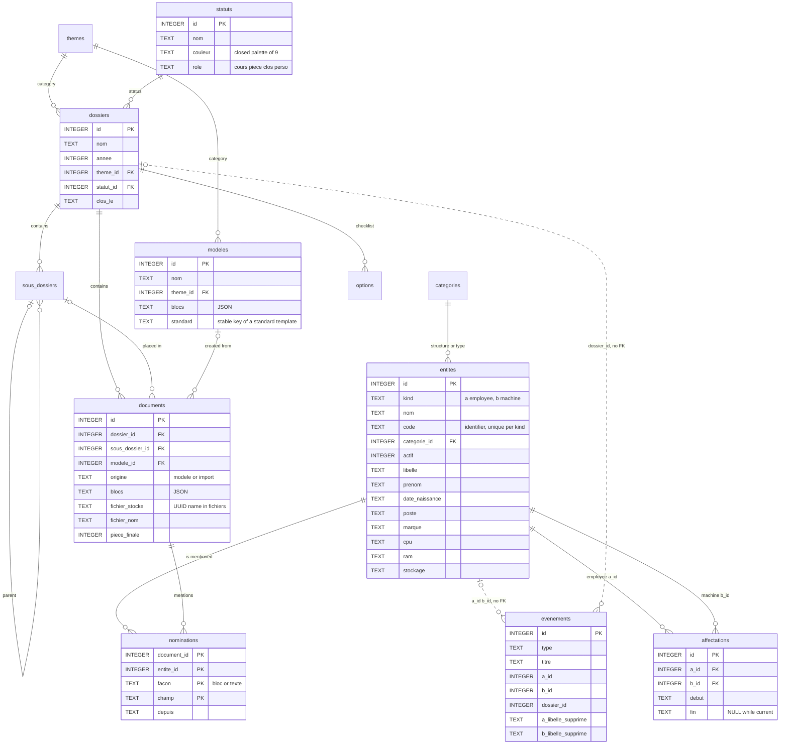

| Table | Role |
| --- | --- |
| `parametres` | key/value settings: `theme` (`system`, `light`, `dark`), `densite` (`eq`, `compact`), `donnees_exemple` (`0`/`1`, also marks an initialised database) |
| `themes` | categories of dossiers and templates (called "catégories" on screen since 1.7) |
| `categories` | structures of employees (`kind = 'a'`) and machine types (`kind = 'b'`), unique per kind |
| `magasin` | keyword list offered by keyword blocks |
| `entites` | employees and machines in one table, distinguished by `kind`; `code` is the identifier (generated for employees, typed for machines), unique per kind without case; `libelle` is the display name (`NAME First name` for an employee) |
| `affectations` | assignment periods of a machine to an employee; a partial unique index allows only one current period (`fin IS NULL`) per pair |
| `modeles` | templates; `blocs` is a JSON array of blocks; `standard` is the stable key of a standard template |
| `dossiers` | dossiers with year, category and status; `clos_le` is set when closed |
| `statuts` | dossier statuses; the three built-in rows have the roles `cours`, `piece`, `clos` (unique), user statuses have the role `perso` |
| `sous_dossiers` | sub-folders, nested through `parent_id`, deleted with their dossier (`ON DELETE CASCADE`) |
| `documents` | documents; `blocs` is the JSON snapshot of the template blocks with the values entered; an import has `fichier_stocke` and `fichier_nom` |
| `options` | checklist items of a dossier |
| `nominations` | mentions of employees and machines in documents (see [6.2](#62-mentions)), deleted with their document |
| `evenements` | history (journal). References are plain integers without foreign keys, so that history survives deletions; `a_libelle_supprime` / `b_libelle_supprime` keep the label of a deleted record |
| `cle_identifiant` | a single row holding the 32-byte random key of employee identifiers |

All SQL is written with bound parameters (`params![…]`); JSON block arrays are validated and bounded before they are written (at most 200 blocks, 10 000 characters per text, 500 table rows, 8 columns, 2 to 12 options of at most 200 characters, 2 MB of JSON).

### 5.2 Migration history

Migrations are SQL files embedded in the executable (`include_str!`) and listed in `db/mod.rs`; the index in the list plus one is the `user_version` after applying it. Some migrations need a Rust step in the same transaction.

| File | Version | Schema change | Rust step |
| --- | --- | --- | --- |
| `001_init.sql` | 1.0 | initial schema: settings, categories, records with a 4-digit code, associations, templates, dossiers attached to one employee and one machine with a fixed status, sub-folders, documents, options, events | — |
| `002_employes_machines.sql` | 1.1 | `entites` rebuilt with employee and machine fields; identifier relaxed to 1–40 characters; old employee codes moved to the history; history wording updated; `modeles.standard` added | standard templates added to an existing database |
| `003_affectations.sql` | 1.2 | `affectations` created; each association becomes a current assignment; `associations` dropped | — |
| `004_etats_citations_identifiants.sql` | 1.3 | `statuts` created with the three built-in statuses; `dossiers` rebuilt with `statut_id` and optional employee and machine; `cle_identifiant` created | random key drawn; every employee identifier recomputed, the old one written to the history |
| `005_nominations.sql` | 1.4 | `dossiers` rebuilt without employee and machine; `documents.modele_id` added; `nominations` created | before the script, each dossier's employee and machine are copied into its documents as blocks; after it, `modele_id` is recovered and mentions are filled, dated from the document's creation |
| `006_fiches_supprimees.sql` | 1.5 | `evenements.a_libelle_supprime` and `b_libelle_supprime` added | — |

Versions 1.5.1 to 1.8.2 did not change the schema. The rules for adding a migration are in [`src-tauri/migrations/README.md`](../src-tauri/migrations/README.md).

### 5.3 Connection settings

Every connection (`db::preparer`) is configured with:

- `SQLITE_DBCONFIG_DEFENSIVE` on and `trusted_schema = OFF`: the schema read from the file is not trusted and cannot be corrupted by ordinary statements;
- `foreign_keys = ON`;
- `secure_delete = ON`: deleted content is overwritten in the file, not only marked free;
- `journal_mode = WAL` and `synchronous = NORMAL` for the database on disk;
- a 5-second busy timeout, for a lock briefly held by another tool (backup software, antivirus).

### 5.4 Opening a database

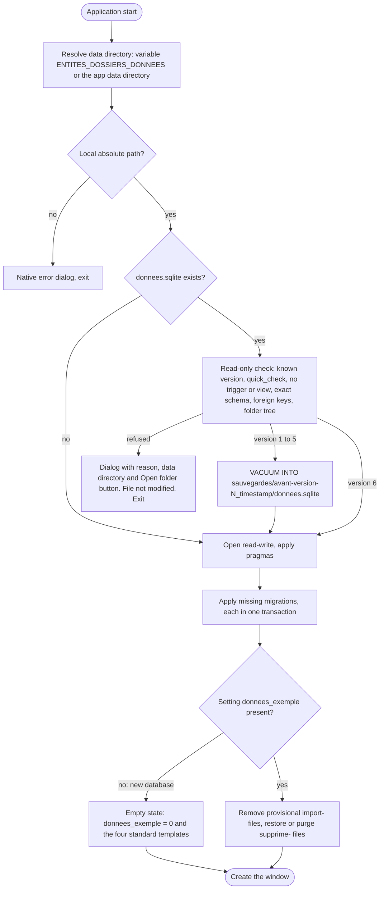

**Read-only verification** (`db::verifier_base`, run on a `SQLITE_OPEN_READ_ONLY` connection in defensive mode, before anything is written):

1. `user_version` must not exceed 6 (a database from a newer version is refused);
2. `PRAGMA quick_check` must return `ok`;
3. there must be no trigger and no view, whatever their name;
4. the normalised content of `sqlite_master` must equal the schema obtained by replaying migrations 1 to `user_version` in memory; only SQLite's own automatic indexes and `sqlite_sequence` / `sqlite_stat*` tables are ignored;
5. `PRAGMA foreign_key_check` must be empty, and the sub-folder tree must be consistent (no cycle, no parent or document in another dossier).

A refused database is never modified. The message gives the reason, the data directory and two ways out: set the file aside so that a new empty database is created, or restore a backup.

**Migrations** (`db::migrer`) run with foreign keys suspended (some migrations rebuild tables that others reference). Each migration runs in its own transaction, which is committed only if `PRAGMA foreign_key_check` is empty and, for 004 and 005, if the number of dossiers is unchanged. `user_version` is updated inside the same transaction.

**First launch.** A database is "new" when it has no `donnees_exemple` setting. It then receives exactly the state that "Effacer toutes les données" produces: `donnees_exemple = 0` and the four standard templates in the category "Support informatique"; the three built-in statuses and the identifier key come from the migrations. An existing database is never emptied or filled at start-up.

### 5.5 Backup policy

| Trigger | Location | Content | Retention |
| --- | --- | --- | --- |
| Upgrade of a version 1–5 database | `sauvegardes/avant-version-<N>_<YYYY-MM-DD_HH-MM-SS>/` | `donnees.sqlite` (`VACUUM INTO`) | never deleted automatically |
| "Effacer toutes les données" or "Recharger les données d'exemple" | `sauvegardes/<YYYY-MM-DD_HH-MM-SS>/` | `donnees.sqlite` and the whole `fichiers/` folder (moved) | the 3 most recent are kept; older ones are deleted only when at least 7 days old |

If a backup cannot be made, the upgrade (`migration_impossible`) or the reset is refused and nothing is changed. Pruning only considers folders whose name is exactly a timestamp, so `avant-version-…` folders and anything else placed in `sauvegardes/` are never removed.

## 6. Domain rules with technical impact

### 6.1 Employee identifiers

An employee's identifier is computed, never typed (`domaine/identifiant.rs`, § 10.5):

- the last name, first name, date of birth and job title are normalised (case, accents, spaces and punctuation ignored);
- they are hashed with HMAC-SHA-256 under a 32-byte key drawn from the operating system's random generator when the database is created, and stored in `cle_identifiant`;
- the first 50 bits of the digest are written as ten characters from the alphabet `0-9 A-Z` without `I`, `L`, `O`, `U`, giving `EMP-XXXXX-XXXXX`;
- on a collision with another employee, the next 50-bit window of the digest is used (five windows per digest), then windows of derived digests;
- the same four values in the same database always give the same identifier, so recreating a deleted employee gives back the same identifier; the identifier is recomputed when one of the four values changes;
- a record missing one of the four values has no identifier and is listed as "to complete".

The key never leaves the module: no public function returns it and it never appears in a message or in the log. The form shows the identifier that would be assigned, live, through `identifiant_employe_apercu`, without writing anything. Machine identifiers are typed by the user (1 to 40 characters, unique without case).

### 6.2 Mentions

A record is *mentioned* (`nominations`, § 11) in a document when:

- an `employe` or `machine` block of the document designates it (`facon = 'bloc'`); or
- its name is written in an entered value — field, multi-line field or table cell (`facon = 'texte'`): for an employee, last name and first name together in either order, as whole words; for a machine, its identifier as a whole word, if it has at least 3 letters or digits. Comparison ignores case and accents.

`champ` is the label of the block (of the column for a table cell) and `depuis` the time the mention appeared. The table is updated when a document is created or saved (new mentions get the current time, vanished ones are removed, the others keep their date) and when a record is created, renamed or changes identifier (its text mentions are recomputed across all documents). Mentions are deleted with their document by cascade. They drive the "documents where this record appears" list on each profile, the dossiers linked to a record, and the "mentioned in …" events of its history, which are computed from the table rather than stored in `evenements`.

A document's variables "Employé · …" and "Machine · …" are read from the first `employe` (respectively `machine`) block of the document that designates a record.

### 6.3 Dossier statuses

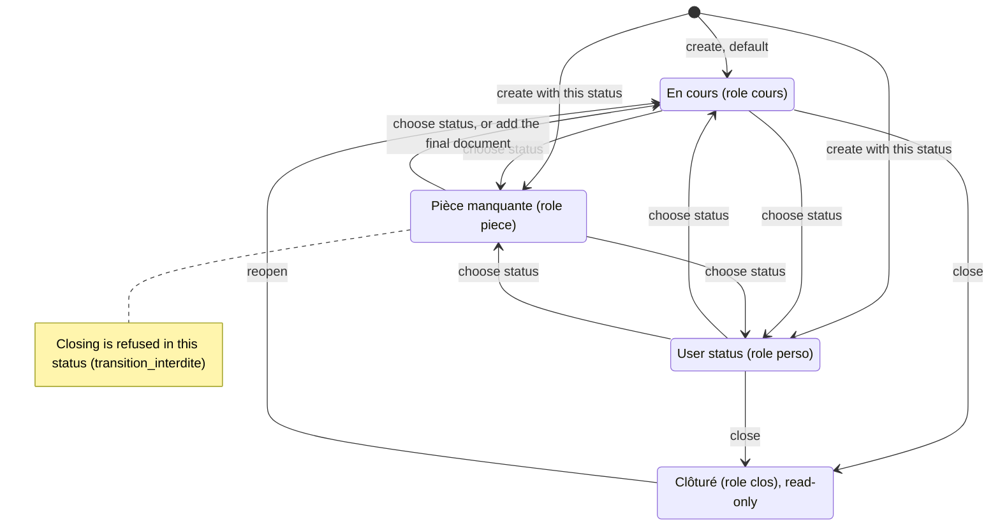

- The three built-in statuses cannot be renamed or deleted (`statut_fourni`). User statuses have a name (unique without case) and a colour from a closed palette of nine (`gris`, `bleu`, `turquoise`, `vert`, `ambre`, `orange`, `rouge`, `rose`, `violet`), enforced by a `CHECK` constraint; a user status can be deleted only when no dossier carries it.
- A dossier cannot be created closed. Adding a document marked as the final document (`piece_finale`) moves a "Pièce manquante" dossier back to "En cours".
- A closed dossier is read-only: every write on it, its sub-folders, documents or checklist is refused by the back end (`dossier_clos`) and disabled in the interface. Only reopening it (back to "En cours") or deleting it as a whole is accepted.
- Every status change writes a history event on the dossier, which also appears in the history of the records mentioned in its documents.
- A dossier can be deleted in any status (see 6.4).

### 6.4 Deletion semantics

Archiving (records, categories, structures, machine types, keywords, templates) is always reversible: an archived item stays visible where it is used but is no longer offered in choice lists. Deletion is definitive and follows these rules, each applied in a single transaction:

| Object | Allowed when | Effect | What is preserved |
| --- | --- | --- | --- |
| Document | its dossier is not closed | row deleted, mentions deleted by cascade, imported copy removed from disk | — |
| Sub-folder | its dossier is not closed | sub-folder and all its content deleted, imported copies removed | — |
| Employee or machine | always (active or archived) | current assignments end (an end event is written on the other record); past assignments, mentions and the record are deleted; its own events are deleted; a `fiche_supprimee` event is added | blocks that designated it keep a copy of the record (`ficheSupprimee`: name, identifier, characteristics), including in closed dossiers, so documents and their variables show the same text; events shared with another record or a dossier stay, with the id set to `NULL` and the label kept in `*_libelle_supprime` |
| Dossier | always, any status | dossier, sub-folders, documents, checklist, mentions and the dossier's events deleted; imported copies removed | each record mentioned in its documents receives a `dossier_supprime` event naming the dossier |
| Template | no document was created from it | template deleted | standard templates can be recreated by "Restaurer les modèles standards" |
| Category | no dossier and no template, active or archived, uses it | deleted (`categorie_utilisee` otherwise, with the counts) | — |
| Structure or machine type | no record, active or archived, uses it | deleted | — |
| Keyword | always | removed from the list | documents keep the written value; renaming a keyword updates the keyword blocks whose value is exactly the old name |
| User status | no dossier carries it | deleted | — |

Because SQLite can reuse the integer id of a deleted row, nothing that survives a deletion keeps the deleted id: blocks keep a copy of the record, and events keep its label as text. The application gives every import its own copy; if a stored copy is nevertheless referenced by another document (only possible in an inconsistent database), it is kept when a document, sub-folder or dossier is deleted. When the deletion of a dossier would reach the content of another dossier, it is refused (`donnees_incoherentes`). The interface asks for confirmation with the real numbers, obtained from preview commands (`entite_suppression_apercu`, `dossier_suppression_apercu`).

### 6.5 Documents and templates

- A template is a JSON array of blocks of 13 types: `titre`, `texte`, `champ`, `zone`, `date`, `case`, `choix`, `tableau`, `magasin`, `variable`, `employe`, `machine`, `signature`. Input blocks can be marked mandatory; the document counts the mandatory fields still empty, without preventing saving or closing.
- Creating a document copies the template's blocks (snapshot): later changes to the template do not affect existing documents. The document keeps a reference to its template (`modele_id`).
- Default names: `Dossier <year>-<NN>` for a dossier, `Document_<NN>` for a document, incremented until free.
- A `signature` block is a checkbox; the back end stores the date at which it was checked and clears it when unchecked.
- An imported file is a document with two optional blocks, "Employé concerné" and "Machine concernée", so that it can mention records like any other document.
- The four standard templates (`domaine/standards.rs`) are identified by a stable key and by name; "Restaurer les modèles standards" recreates those that no active template carries by name, without touching existing templates.

## 7. File storage

Imported files are copied into the `fichiers` directory of the data directory; the database only stores the copy's name. All the logic is in `domaine/copies.rs`, with one rule: every read, open, export or deletion of a copy goes through `chemin_copie`.

| Step | Control |
| --- | --- |
| Choosing the file | the native "Open" dialog is shown by Rust (`document_importer`); no path ever comes from the interface |
| Source check | absolute path on a drive or a network share; device paths, reserved names (`CON`, `NUL`, `COM1`…), alternate data streams and raw `\\?\` paths refused; links resolved and re-checked; regular file only; 200 MB at most, checked again after copying |
| Naming | `<random UUID>.<extension>`; the extension is kept only if it is in the allow-list, otherwise `.bin` |
| Allow-list (25 extensions) | `pdf png jpg jpeg gif webp bmp tif tiff heic heif txt csv rtf doc docx xls xlsx ppt pptx odt ods odp msg eml` — none executable by Windows |
| Zone mark | every copy receives a `Zone.Identifier` stream with `ZoneId=3` ("downloaded from the Internet"), unless a stricter mark is already present, so Office and PDF readers open it in protected mode |
| Atomicity | the copy is written as `import-<name>` outside the database lock, renamed just before the database insert, and removed if the insert fails |
| Preview | decided by the first bytes of the stored file, never by its name: PNG, JPEG, GIF, WebP and BMP signatures give an image preview, `%PDF-` a PDF preview, anything else no preview |
| Opening with the default application | only for a valid stored name whose extension is in the allow-list |
| Confinement | `chemin_copie` accepts only a name of the exact form UUID plus extension, a regular file (not a link or folder), whose canonical parent is exactly the `fichiers` directory |
| Export ("Save a copy") | native "Save as" dialog in Rust, original name sanitised; destination cannot be a device or the `fichiers` directory; the exported copy also receives the zone mark |
| Deletion | copies are first renamed `supprime-<name>`; if one is locked by another application the whole deletion is refused (`fichier_ouvert`) and everything is put back; they are purged after the database commit |
| Start-up cleanup | only provisional files are touched: `import-…` files are removed; a `supprime-…` file whose name is still referenced is put back, otherwise removed. A regular copy is never deleted, even if unreferenced |

The interface displays previews through Tauri's asset protocol, whose scope is limited to the `fichiers` directory (`tauri.conf.json` and `asset_protocol_scope().allow_directory` at start-up).

## 8. Front-end architecture

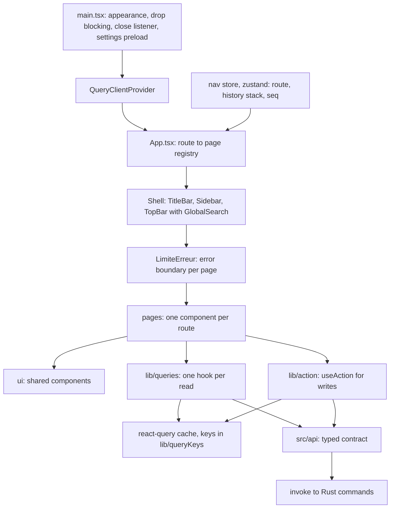

**Entry point** (`src/main.tsx`). Before rendering, it applies the last known theme and density from `localStorage` (no flash), installs the file-drop blocker, subscribes to the `fermeture-demandee` event, and reads the settings from the back end with a 1.5-second limit, putting them in the query cache.

**Navigation** (`src/nav`). There is no URL router. A small `zustand` store keeps the current route, a history stack and a counter `seq`. `go` pushes, `root` clears the history (sidebar entries), `back` pops (Back button and Alt+Left), `replace` swaps the current page, `update` changes route parameters without remounting. Each new page is mounted with `key={seq}`, so its local state starts fresh. Routes are a typed union of 11 names (`dashboard`, `rep`, `fiche`, `dossiers`, `dossier`, `creation`, `form-entite`, `form-dossier`, `studio`, `magasin`, `parametres`).

**Server data.** `@tanstack/react-query` caches every read. Each read of the contract has one hook in `src/lib/queries.ts`, and every query key is defined in `src/lib/queryKeys.ts`. The client is configured for a local database: `staleTime: 0`, no retry, no refetch on window focus.

**Writes and invalidation.** Every write goes through `useAction` (`src/lib/action.ts`), which calls the API and, on success, invalidates **the whole cache** by default: only the queries currently displayed are re-read, which is cheap with a local database and always correct. Frequent writes may restrict invalidation; the autosave of document blocks uses `'none'` so that the editor is not re-read while the user types.

**Life of a command.** The example below closes a dossier.

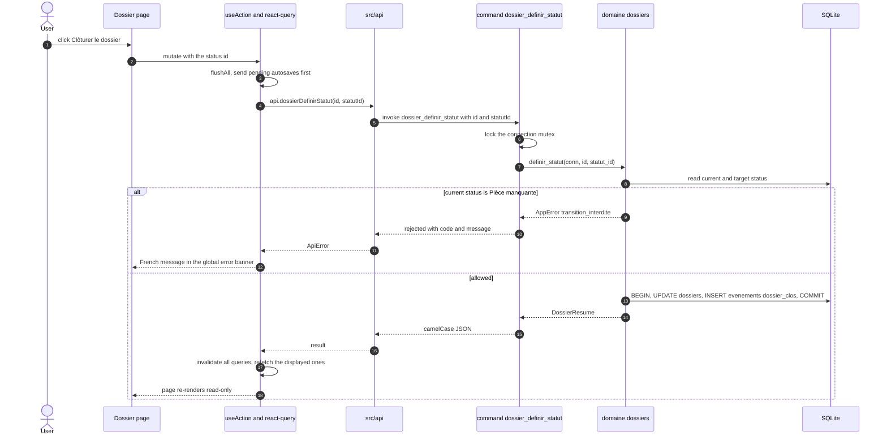

**Errors.** A failed write shows the back end's French message in a banner at the top of the page (global) or next to a form (`errors: 'local'`). A rendering error inside a page is caught by `LimiteErreur`, which keeps the title bar, sidebar and search usable and offers to go back.

**Autosave.** Document editors save automatically about 400 ms after the last keystroke (`src/pages/blocs/autosave.ts`). Pending values are sent immediately when the editor unmounts, when an action calls `flushAll()` (closing a dossier, duplicating a template), and when the window closes.

**Styles.** The CSS comes from [`design/prototype-entites-dossiers.html`](../design/prototype-entites-dossiers.html), the original static HTML prototype the application was built from, split into files in `src/styles/` (tokens, base, components, print). Theme and density are attributes on `<html>` (`data-theme`, `data-density`). The production CSP has no `'unsafe-inline'` for styles, so the code never injects `<style>` elements or `style` attributes in markup; values that the user chooses, such as status colours, are CSS classes from a closed palette. The print stylesheet keeps only the document "paper". Because the CSP sets `form-action 'none'`, every form handler calls `preventDefault()`.

**Long lists.** Long lists and large tables are rendered in bounded slices with a "show more" control (`src/lib/borne.ts`, `src/ui/Borne.tsx`).

Front-end conventions for writing a page are in [`socle-front.md`](socle-front.md) (French); the structure is described in [`src/README.md`](../src/README.md).

## 9. Security architecture

The application is local and single-user. The threat model (detailed in [`audit-securite.md`](audit-securite.md), French, which contains the audit of version 1.0.0 and the review of version 1.8.2) considers: a malicious imported file; a tampered database or data folder received from someone else; hostile script that would run in the interface through one of those and call back-end commands; and another program or account on the same machine.

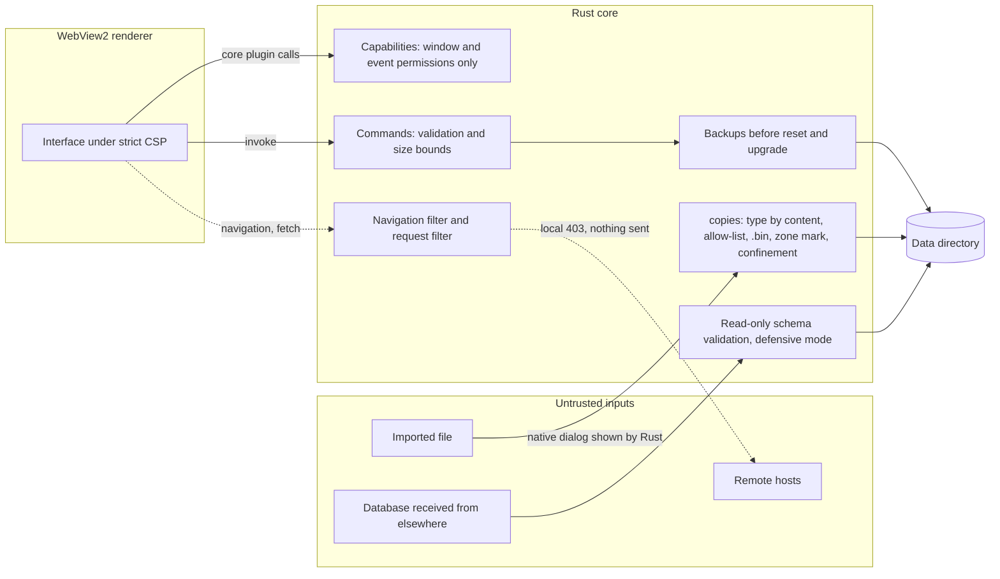

| Control | Where | Effect |
| --- | --- | --- |
| Content Security Policy | `tauri.conf.json` (`app.security.csp`) | `default-src 'self'`; scripts and styles only from the bundle; images and media from `self`, the asset protocol, `blob:` and `data:`; frames only from the asset host; connections only to `self` and IPC; `object-src 'none'`, `base-uri 'self'`, `form-action 'none'`. A separate `devCsp` relaxes inline styles and scripts and allows the Vite websocket in development only |
| Minimal capabilities | `capabilities/default.json` | the interface may only listen to events and minimise, maximise, close, destroy and drag its window; it has no file-system, shell, dialog or opener permission. A Rust test fails if this list changes |
| No global Tauri object | `withGlobalTauri: false` | `window.__TAURI__` is not injected; the interface uses the bundled `@tauri-apps/api` module |
| Navigation and request filters | `fenetre.rs` | navigation limited to the application origin; new windows and downloads refused; any request to another host answered locally with 403 |
| Paths never come from the interface | `commandes/mod.rs` | import and export dialogs run in Rust; commands take ids, not paths |
| File handling | `domaine/copies.rs` | see [7](#7-file-storage) |
| Database validation | `db/mod.rs` | read-only check before use, defensive mode, untrusted schema, `secure_delete` |
| Bounds | `domaine/modeles.rs`, `domaine/entites.rs`, `domaine/mod.rs` | size limits on names, fields, blocks and JSON, on write and on read |
| Error hygiene | `error.rs` | no path or system message is sent to the interface |
| Data directory override | `etat.rs` | `ENTITES_DOSSIERS_DONNEES` must be an absolute path on a local, non-network drive |
| Release hardening | `scripts/compilation.mjs`, `Cargo.toml` | Control Flow Guard, high-entropy 64-bit ASLR, DEP and CET shadow-stack compatibility checked in the PE header; build paths remapped; `overflow-checks = true` and `panic = "abort"` in release |
| Installer | `tauri.conf.json`, `windows/hooks.nsh` | WebView2 is never downloaded; per-user install; restricted permissions when installed outside the profile; SHA-256 published with each installer |

Accepted residual risks, documented in the audit: the installer and executable are not code-signed; the data is stored unencrypted (protected by Windows profile permissions; BitLocker recommended); the executable honours `ENTITES_DOSSIERS_DONNEES` and the WebView2 environment variables (`WEBVIEW2_USER_DATA_FOLDER`, `WEBVIEW2_ADDITIONAL_BROWSER_ARGUMENTS`), which a program already running under the user's account could set; on an attempted navigation to an external host, WebView2 opens a speculative TCP connection before the filter applies, without sending any HTTP request.

The vulnerability reporting policy is in [`SECURITY.md`](../SECURITY.md).

## 10. Build, packaging and release

### 10.1 Front-end build

`npm run build` runs `tsc` (strict type-check) then `vite build`, which writes the bundle to `dist/`. Tauri embeds `dist/` in the executable (`build.frontendDist`). In development, `npm run tauri dev` starts Vite on `http://localhost:1420` (strict port; `src-tauri` is excluded from Vite's file watcher) and the debug build allows this origin in the navigation filter and in `devCsp`.

### 10.2 Release build and delivery

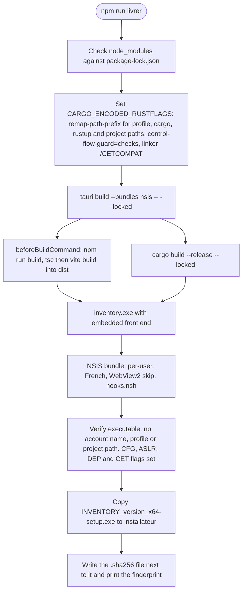

- **Cargo release profile** (`src-tauri/Cargo.toml`): `codegen-units = 1`, `lto = true`, `opt-level = 3`, `panic = "abort"`, `strip = true`, `overflow-checks = true`.
- **Compiler flags** (`scripts/compilation.mjs`), passed through `CARGO_ENCODED_RUSTFLAGS` (any `RUSTFLAGS` is ignored with a warning): `--remap-path-prefix` for the user profile, `CARGO_HOME`, `RUSTUP_HOME` and the project directory; `-C control-flow-guard=checks`; and `-C link-arg=/CETCOMPAT`, which marks the executable compatible with hardware-enforced stack protection (Intel CET / AMD shadow stack).
- **Executable checks**: the binary is scanned in ASCII and UTF-16 for the build account name, the profile path and the project path; the PE `DllCharacteristics` must declare Control Flow Guard (`0x4000`), ASLR (`0x40`), high-entropy 64-bit ASLR (`0x20`) and DEP (`0x100`), and the debug directory must carry the CET-compatible extended characteristic. Any failure stops the delivery.
- **Locked dependencies**: `cargo build --locked`, and `node_modules` must match `package-lock.json` exactly.
- `node scripts/livrer.mjs --sans-installateur` builds and checks the executable without bundling; the end-to-end suite uses it (`npm run e2e:build`) so that the tested executable is built exactly like the delivered one.

The `.sha256` file uses the `sha256sum` format (`<HEX> *<file name>`); `Get-FileHash` prints the same value.

### 10.3 Installer

The Tauri bundler produces an NSIS installer configured in `tauri.conf.json`:

| Setting | Value | Reason |
| --- | --- | --- |
| `bundle.targets` | `["nsis"]` | single `.exe` installer |
| `nsis.installMode` | `currentUser` | no administrator rights; default folder `%LOCALAPPDATA%\INVENTORY` |
| `nsis.languages` | `["French"]`, no language selector | French product |
| `windows.webviewInstallMode` | `skip` | the installer never downloads anything; WebView2 is part of Windows 11 |
| `nsis.installerHooks` | `./windows/hooks.nsh` | upgrade from the former product and folder permissions |

**Pre-install hook** (`NSIS_HOOK_PREINSTALL`). Versions up to 1.4.0 were installed as "Entités et Dossiers". If an uninstall key with that name exists (current user, then machine-wide), the hook reads the old installation folder from the registry. Because the current-user part of the registry can be changed by any program of the account, the folder is used only if it is an absolute path on a drive letter, not a drive root, without `.` or `..` components, without `:` after the drive letter, not a network or device path, **and** if it contains the old executable. In that case the hook asks to close the old application if it is running, deletes its Start menu and desktop shortcuts only if they point to the old executable, deletes the two named files `entites-dossiers.exe` and `uninstall.exe`, and removes the old folder only if it is then empty. Otherwise no file or shortcut is touched. In both cases the old registry keys (fixed names) are removed. The hook deliberately does not run the old uninstaller, which contains an instruction that can delete the data directory, and contains no recursive deletion. If the old executable cannot be deleted, installation stops with a message and the old version stays registered.

The hook is tested by `npm run test:installateur` (`tests/installateur/crochet-preinstall.mjs`), which compiles it into a small test installer with `makensis` and runs it against fake former installations in temporary folders and a test registry key, checking what is deleted and what is not for each registered value. A Rust configuration test also checks that the folder validation comes before the first deletion.

**Post-install hook** (`NSIS_HOOK_POSTINSTALL`). If the installation folder is outside the user's profile, the hook reads the installing user's SID from the process token and uses `icacls` to remove inherited permissions and grant full control only to that user, `SYSTEM` (`S-1-5-18`) and `Administrators` (`S-1-5-32-544`), designated by SID so that it works whatever the Windows language. Inside the profile, or if the SID cannot be read, nothing is changed.

The application identifier `fr.entitesdossiers.app` did not change with the product name, so the data directory and the WebView2 profile are the same before and after the upgrade.

### 10.4 Continuous integration

The workflow `.github/workflows/ci.yml` runs on every push and pull request, on a Windows runner, with read-only repository permissions. Node.js is set up from `.nvmrc`. It has two jobs:

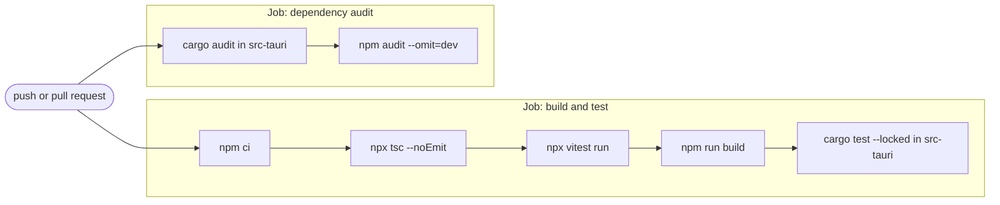

The end-to-end suite and the installer hook test are not run in CI: the former needs an interactive Windows session and drives the real mouse and keyboard, the latter writes to the registry. Installers are built locally with `npm run livrer` and attached to GitHub releases with their `.sha256` file.

## 11. Testing strategy

| Level | Tool | Location | Scope | Count |
| --- | --- | --- | --- | --- |
| Back end | `cargo test` | `src-tauri/src/**` (`#[cfg(test)]` modules, `domaine/tests*.rs`) | business rules on in-memory databases, migrations from every former schema version, database refusal cases on temporary files, file confinement, window filters, configuration guards (capabilities, CSP, installer, release profile) | 173 test functions |
| Front end | Vitest | `src/**/*.test.ts` | pure logic: block handling, filters, history links, deletion texts, close protocol, error boundary | 195 tests in 23 files |
| End to end | Node.js + Playwright Core over the WebView2 DevTools protocol | `tests/e2e` | the production executable driven like a user, including native dialogs | 35 scenarios |
| Installer hook | Node.js + `makensis` | `tests/installateur` | the pre-install hook against fake former installations and registry values | one script (`npm run test:installateur`) |

Counts as of version 1.8.2: Rust test functions counted as `#[test]` attributes under `src-tauri/src` (one of them runs on Windows only); Vitest tests counted as `it(`/`test(` calls in `*.test.ts` files; scenarios counted in the `SCENARIOS` list of `tests/e2e/scenarios/index.mjs`.

Configuration guard tests in `lib.rs` fail if the capability list, the production CSP, the code-created window, the WebView2 install mode, the installer hooks or `overflow-checks` change, so that a security setting cannot be loosened by accident.

**End-to-end harness.**

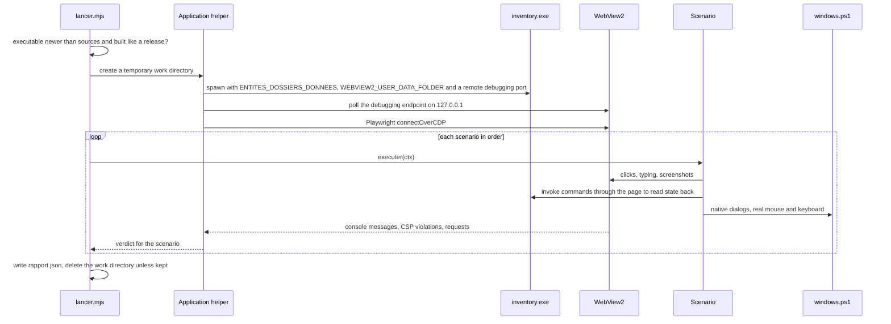

Besides its own assertions, a scenario fails if the console shows an error or a warning, if a CSP violation is reported, or if any request goes anywhere other than the application's own hosts. Usage, options and how to write a scenario are in [`tests/README.md`](../tests/README.md). The same harness produces the documentation screenshots (`npm run captures`), from the fictitious example data in a temporary data directory.

## 12. Operational notes

**Locations.**

```
%APPDATA%\fr.entitesdossiers.app\        data directory
    donnees.sqlite                         database (plus -wal and -shm while open)
    fichiers\                              imported copies: <uuid>.<ext>, provisional import-… and supprime-…
    sauvegardes\                           automatic backups
        YYYY-MM-DD_HH-MM-SS\               before a reset: donnees.sqlite and fichiers\
        avant-version-N_YYYY-MM-DD_HH-MM-SS\   before an upgrade: donnees.sqlite
    journal-erreurs.log                    technical error log (rotated to .log.1 above 1 MiB)
%LOCALAPPDATA%\fr.entitesdossiers.app\   WebView2 profile
%LOCALAPPDATA%\INVENTORY\                program files (default installation folder)
```

**Resetting.** The "Données" section of Settings offers "Effacer toutes les données" (back to the first-launch state; display preferences, the three built-in statuses and the identifier key are kept) and "Recharger les données d'exemple"; both make a backup first. To start from a brand-new database, close the application and rename or move `donnees.sqlite`; imported copies in `fichiers` are not touched.

**Test-only environment variable.** `ENTITES_DOSSIERS_DONNEES` replaces the data directory. It must be an absolute path on a local drive; a network path, a mapped network drive or a device path prevents start-up. It is used by the end-to-end suite and is not set in normal use. The WebView2 variables `WEBVIEW2_USER_DATA_FOLDER` and `WEBVIEW2_ADDITIONAL_BROWSER_ARGUMENTS` are honoured by WebView2 itself; the latter can open a debugging port through which any local program could drive the application. If the application behaves unexpectedly, check that none is set:

```powershell
Get-ChildItem Env:ENTITES*, Env:WEBVIEW2*
```

**Known limits.**

- Windows 11 only; WebView2 must be present.
- One user, one machine: no synchronisation, no multi-user access.
- The installer and executable are not code-signed (SmartScreen warning); verify the SHA-256.
- Data is not encrypted at rest.
- The interface is in French only.
- A link inside a previewed PDF could lead the preview frame to another stored file served as a page (documented as CA-11 in the audit); the script would not have access to the application's commands.
- The installer's permission hook does not change the permissions of an installation folder outside the profile that already existed with broader permissions (CA-07 in the audit): keep the proposed folder.

## 13. Glossary of French identifiers

The code uses French names. The main ones:

| Identifier | Meaning |
| --- | --- |
| `entite`, `fiche`, `kind` | a record: employee (`kind = 'a'`) or machine (`kind = 'b'`) |
| `code`, `identifiant`, `libelle` | the record's identifier, its identifier logic, its display name |
| `categorie` | structure of an employee or type of a machine |
| `theme` | category of dossiers and templates ("catégorie" on screen) |
| `magasin`, `mot-clé` | keyword list used by keyword blocks |
| `affectation` (commands `association_*`) | assignment of a machine to an employee |
| `dossier`, `sous_dossier`, `option` | dossier, sub-folder, checklist item |
| `statut`, `role` | dossier status and its role (`cours`, `piece`, `clos`, `perso`) |
| `document`, `modele`, `bloc` | document, template, block |
| `nomination`, `facon`, `champ` | mention, how a record is mentioned, field where it is mentioned |
| `evenement`, `journal` | history event, history |
| `parametres`, `donnees`, `sauvegardes`, `fichiers` | settings, data, backups, imported files |
| `copies` | stored copies of imported files |
| `livrer`, `compilation` | deliver, build |
