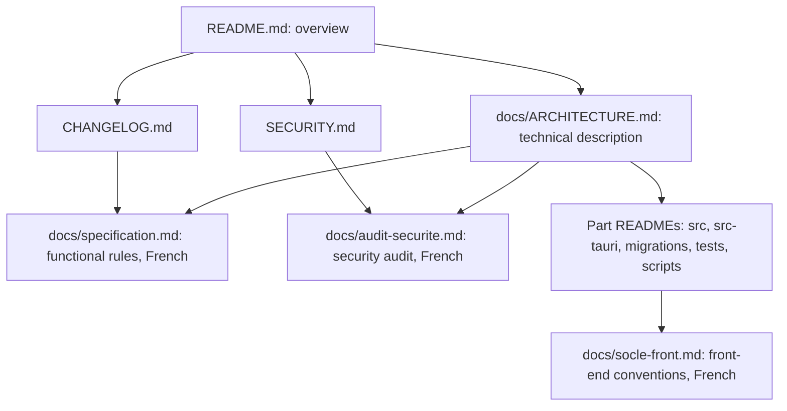

# Documentation

This folder holds the reference documentation of INVENTORY. Documents written for developers and reviewers in general are in English; the detailed functional documents, written alongside the application, are in French like its user interface.

| Document | Language | What it is | Read it when |
| --- | --- | --- | --- |
| [`ARCHITECTURE.md`](ARCHITECTURE.md) | English | complete technical description: process model, typed contract, back-end modules, data model and migrations, domain rules, file storage, front end, security architecture, build and release, tests, operations, glossary of French identifiers | you want to understand how the application works |
| [`specification.md`](specification.md) | French | functional specification: data model, business rules, the front-end/back-end contract in TypeScript, screens, and one section per version (§ 8 to § 18) describing what changed and why | you change a business rule or the contract |
| [`socle-front.md`](socle-front.md) | French | front-end conventions: pages, navigation, reading data, writing and cache invalidation, error display, shared components | you write or change a page |
| [`audit-securite.md`](audit-securite.md) | French | security audit of version 1.0.0 (threat model, findings with severity and status, changes made, counter-audit, residual risks, verification results) and security review of version 1.8.2, which covers the code added in versions 1.1 to 1.8.1 | you review the security of the application |
| `images/` | — | screenshots used by the root README (fictitious example data) | — |

Elsewhere in the repository:

| Document | What it is |
| --- | --- |
| [`../README.md`](../README.md) | project overview, installation, data location, building, testing |
| [`../CHANGELOG.md`](../CHANGELOG.md) | changes per version |
| [`../CONTRIBUTING.md`](../CONTRIBUTING.md) | how to contribute and the checks required before a pull request |
| [`../SECURITY.md`](../SECURITY.md) | security policy and how to report a vulnerability |
| [`../src/README.md`](../src/README.md) | front end |
| [`../src-tauri/README.md`](../src-tauri/README.md) | back end |
| [`../src-tauri/migrations/README.md`](../src-tauri/migrations/README.md) | database migrations |
| [`../tests/README.md`](../tests/README.md) | end-to-end tests |
| [`../scripts/README.md`](../scripts/README.md) | build and delivery scripts |

## How the documents relate

Code comments refer to sections of the specification by number (for example "§ 10.5"), and the English documents use the same numbers, as well as the finding references of the audit (for example "CA-11").

## Language

The application's interface, its code identifiers and its comments are in French. The English documents explain the French terms the first time they appear; [`ARCHITECTURE.md`](ARCHITECTURE.md#13-glossary-of-french-identifiers) ends with a glossary of the main identifiers.
