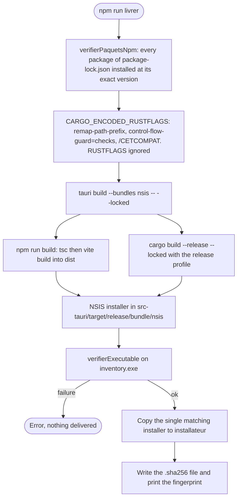

# Build and delivery scripts (`scripts/`)

Two Node.js modules produce the release build of INVENTORY. They are the only supported way to build an installer for distribution, and the end-to-end suite uses them so that the executable it tests is built exactly like the delivered one.

| File | Role |
| --- | --- |
| `livrer.mjs` | command-line entry point (`npm run livrer`): builds, then copies the installer to `installateur/` and writes its SHA-256 file |
| `compilation.mjs` | shared build logic: dependency check, hardened compiler flags, `tauri build`, executable verification (`verifierExecutable`, `cetCompatible`). Also imported by `tests/e2e/lancer.mjs` to check the executable under test |

Nothing specific to a machine is written in these files: paths and the account name are read at run time.

## Usage

```powershell
npm ci                                          # node_modules must match package-lock.json exactly
npm run livrer                                  # release executable + NSIS installer + SHA-256
node scripts/livrer.mjs --sans-installateur     # release executable only (used by npm run e2e:build)
```

Output of `npm run livrer` (the `installateur/` folder is not versioned):

```
installateur\INVENTORY_<version>_x64-setup.exe
installateur\INVENTORY_<version>_x64-setup.exe.sha256
```

The version is read from `src-tauri/tauri.conf.json`. The `.sha256` file has the `sha256sum` format, `<HEX> *<file name>`, in upper case; `Get-FileHash -Algorithm SHA256` prints the same value.

## Pipeline



### What `compilation.mjs` enforces

1. **Locked dependencies.** Every entry of `package-lock.json` must be installed in `node_modules` at exactly its locked version (run `npm ci` otherwise), and Cargo runs with `--locked`.
2. **Compiler flags**, passed through `CARGO_ENCODED_RUSTFLAGS` (which supports paths with spaces); an existing `RUSTFLAGS` is ignored with a warning:
   - `--remap-path-prefix` replaces the user profile, `CARGO_HOME`, `RUSTUP_HOME` and the project directory with neutral names (`C:\profil`, `C:\cargo`, `C:\rustup`, `C:\projet`), so panic messages of dependencies carry no path of the build machine;
   - `-C control-flow-guard=checks` enables Windows Control Flow Guard;
   - `-C link-arg=/CETCOMPAT` marks the executable compatible with hardware-enforced stack protection (Intel CET / AMD shadow stack), so Windows protects return addresses on processors that support it.
3. **Build.** `tauri build --bundles nsis` (or `--no-bundle` with `--sans-installateur`), with `--locked` passed to Cargo. Tauri runs `npm run build` first (`beforeBuildCommand`), and the Cargo release profile applies LTO, one codegen unit, `opt-level = 3`, `panic = "abort"`, `strip` and `overflow-checks`.
4. **Executable verification** (`verifierExecutable`):
   - the binary must not contain the current Windows account name, the user profile path or the project path, searched case-insensitively in ASCII and UTF-16;
   - the PE header's `DllCharacteristics` must declare Control Flow Guard (`0x4000`), ASLR (`0x40`), high-entropy 64-bit ASLR (`0x20`) and DEP (`0x100`);
   - the debug directory must contain the extended characteristics entry with the CET-compatible bit, set by `/CETCOMPAT`.

Any failure stops the script with a non-zero exit code and nothing is copied to `installateur/`. `livrer.mjs` also refuses to continue if it finds zero or several installers for the current version in the bundle folder.

## Notes

- `npm run tauri build` still works for a quick local trial, but without these flags and checks. Because the compiler flags are part of Cargo's build fingerprint, switching between the two rebuilds every Rust dependency.
- The installer is configured in `src-tauri/tauri.conf.json` and `src-tauri/windows/hooks.nsh`; see [`../src-tauri/README.md`](../src-tauri/README.md) and [`../docs/ARCHITECTURE.md`](../docs/ARCHITECTURE.md#10-build-packaging-and-release).
- Releases: build with `npm run livrer`, then attach both the installer and its `.sha256` file to the GitHub release.
- The end-to-end suite ([`../tests/README.md`](../tests/README.md)) runs `verifierExecutable` on the executable it tests and refuses one that was not built this way.
