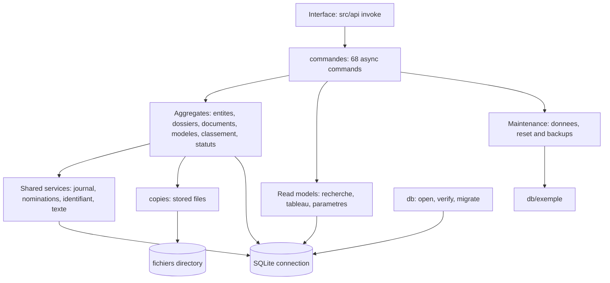

# Back end (`src-tauri/`)

The Rust core of INVENTORY, built on Tauri 2. It owns the SQLite database, the stored copies of imported files, the native dialogs and the window. The interface reaches it only through 68 commands, mirrored one-to-one by the TypeScript contract in [`../src/api/`](../src/api/). Module and command names are in French; a glossary is at the end of [`../docs/ARCHITECTURE.md`](../docs/ARCHITECTURE.md#13-glossary-of-french-identifiers).

## Structure

```
src-tauri/
  Cargo.toml, Cargo.lock      crate `entites-dossiers` (library `entites_dossiers_lib`), dependencies, release profile
  build.rs                    tauri-build
  tauri.conf.json             product name, window, CSP, asset protocol scope, NSIS bundle
  capabilities/default.json   the only permissions granted to the interface
  windows/hooks.nsh           NSIS pre-install and post-install hooks
  icons/                      application icons
  migrations/                 SQL migrations 001 to 006 (see migrations/README.md)
  src/
    main.rs                   entry point (no console window in release)
    lib.rs                    builder, plugins, setup, command registration, configuration guard tests
    etat.rs                   data directory, shared state (one connection behind a mutex)
    fenetre.rs                window creation, navigation and request filters, close protocol
    error.rs                  AppError { code, message }, error log
    commandes/mod.rs          thin #[tauri::command] wrappers; import and export dialogs
    db/
      mod.rs                  open, read-only verification, pragmas, backup, migrations
      migration5.rs           Rust part of migration 005
      exemple.rs              fictitious example data, loaded on demand
    domaine/                  business logic, one module per aggregate, plus tests per version
```

`gen/` (generated capability schemas) and `target/` are not versioned.

## Layers



- **Commands** (`commandes/mod.rs`) are thin: they lock the connection, call one domain function and return its result. The only logic they hold is what needs the Tauri `AppHandle`: native file dialogs (import, export), opening a file or the data directory with the default application, and system information. Commands are `async`, so they run off the UI thread.
- **Domain** (`domaine/`) functions take a `&rusqlite::Connection` (and the `fichiers` path when files are involved). They validate input, enforce the business rules, write in a transaction, and add history events in the same transaction. They never depend on Tauri, which is why they are tested on in-memory databases.
- **Database** (`db/`) opens the file, checks an existing database read-only, makes a backup before upgrading it, applies migrations, and configures the connection (defensive mode, foreign keys, `secure_delete`, WAL).

| Domain module | Responsibility |
| --- | --- |
| `entites` | employees and machines, validation, suggestions (8 at most), assignments, deletion of a record |
| `identifiant` | `EMP-XXXXX-XXXXX` identifiers: HMAC-SHA-256 with a per-database random key |
| `dossiers` | dossiers, sub-folders, checklist, status and category changes, deletion of a dossier |
| `statuts` | three built-in statuses and user statuses with a closed colour palette |
| `documents` | documents from templates and imports, block saving, deletion, export |
| `modeles`, `standards` | templates, 13 block types, size bounds, the four standard templates |
| `nominations` | mentions of employees and machines in documents |
| `copies` | stored copies: path checks, type by content, allow-list, zone mark, set-aside deletion, start-up cleanup |
| `classement` | categories, structures, machine types, keyword list |
| `journal` | history events |
| `recherche`, `tableau` | global search (50 results per group), dashboard |
| `parametres`, `donnees` | display settings, first launch, reset with backup and retention |
| `texte` | case- and accent-insensitive comparison |

## Key concepts

- **Error model.** Every command returns `Result<T, AppError>`. `AppError` serialises to `{ code, message }`; `message` is French and shown as is. Conversions from SQLite, I/O, JSON and Tauri errors log the detail in `journal-erreurs.log` and return a generic message, so no path or system message reaches the interface.
- **Single connection.** `Etat` holds one `Mutex<Connection>`; every command locks it, so writes are serialised. Long blocking work without the database (file dialogs, file copies) runs outside the lock.
- **Closed dossier.** Every write that touches a dossier, its sub-folders, documents or checklist calls `exiger_modifiable` and is refused with `dossier_clos` when the dossier is closed.
- **History.** Business writes add a row to `evenements` in the same transaction. Event references are plain integers without foreign keys, so history survives deletions; a deleted record's label is kept as text.
- **Window.** The main window is created by `fenetre::creer`, not by the configuration, so that its navigation filter, new-window and download refusal and request filter are in place before the page loads. Closing is driven by Rust with a 3.5-second deadline.
- **Data directory.** `%APPDATA%\fr.entitesdossiers.app`, from the application identifier, unless `ENTITES_DOSSIERS_DONNEES` points elsewhere (used by the end-to-end suite; must be an absolute path on a local drive).

## Configuration

| File | Content |
| --- | --- |
| `tauri.conf.json` | `productName` INVENTORY, `mainBinaryName` inventory, `identifier` `fr.entitesdossiers.app`; one window 1280 x 800 (minimum 1024 x 640), no decorations, `create: false`, `dragDropEnabled: false`; production CSP and development CSP; asset protocol limited to `$APPDATA/fichiers/**`; NSIS bundle, per-user, French, WebView2 install mode `skip`, installer hooks |
| `capabilities/default.json` | event listen and unlisten; window minimise, maximise toggle, close, destroy, start dragging, is-maximised. Nothing else |
| `Cargo.toml` | `rusqlite` with `bundled`, `hmac` + `sha2` + `getrandom`, Windows-only `webview2-com` and `windows` crates for the request filter; release profile with LTO, one codegen unit, `panic = "abort"`, `strip`, `overflow-checks` |
| `windows/hooks.nsh` | pre-install: removes a former "Entités et Dossiers" installation without running its uninstaller and without touching data; the old folder read from the registry is used only if it is a safe absolute drive path that contains the old executable (tested by `npm run test:installateur`); post-install: restricts the installation folder's permissions when it is outside the user profile |

The tests in `lib.rs` (`tests_configuration`) fail if the capability list, the production CSP, the code-created window settings, the installer settings (including the order of the folder check and the first deletion in the pre-install hook) or `overflow-checks` change.

## Running and verifying

```powershell
cd src-tauri
cargo test --locked        # all back-end tests (business rules, migrations, refusal cases, filters, configuration)
cargo test tests_v16       # only the tests of one module, here the dossier deletion tests
```

From the repository root, `npm run tauri dev` runs the application in debug mode and `npm run livrer` builds the hardened release and the installer ([`../scripts/README.md`](../scripts/README.md)).

## Adding a command

1. Write the business function in the right `domaine/` module, taking `&Connection`, with its tests (`domaine/tests_*.rs` or a `#[cfg(test)]` module).
2. Add a thin `#[tauri::command] pub async fn` in `commandes/mod.rs`, named in snake_case after the TypeScript function, and register it in `generate_handler!` in `lib.rs`.
3. Add the type to `src/api/types.ts` and the function to the `api` object in `src/api/index.ts`, with camelCase argument names.
4. Use parameterised SQL only; bound every text and collection that comes from the interface; return French messages.
5. Do not add a permission to `capabilities/default.json`: anything that needs the system (dialogs, opening files) is done in Rust.

## See also

- [`migrations/README.md`](migrations/README.md): schema history and rules for new migrations
- [`../docs/ARCHITECTURE.md`](../docs/ARCHITECTURE.md): data model, domain rules, security, build
- [`../docs/specification.md`](../docs/specification.md): functional specification and contract (French)
