# Database migrations (`src-tauri/migrations/`)

The SQLite schema of INVENTORY is defined only by these SQL files. Each file is embedded in the executable (`include_str!` in [`../src/db/mod.rs`](../src/db/mod.rs)) and applied in order; after file *n* is applied, `PRAGMA user_version` is *n*. The current schema version is **6**.

The same files serve a second purpose: when an existing database is opened, its schema is compared with the schema obtained by replaying these files in memory up to its `user_version`. Any difference makes the database refused. This is why **an existing migration must never be edited**.

## History

```mermaid
flowchart LR
    v0(["new file, version 0"]) -- "001_init" --> v1["1: application 1.0"]
    v1 -- "002_employes_machines" --> v2["2: application 1.1"]
    v2 -- "003_affectations" --> v3["3: application 1.2"]
    v3 -- "004_etats_citations_identifiants" --> v4["4: application 1.3"]
    v4 -- "005_nominations" --> v5["5: application 1.4"]
    v5 -- "006_fiches_supprimees" --> v6["6: application 1.5 to 1.8.2"]
```



| File | Introduced in | Change | Rust step in the same transaction |
| --- | --- | --- | --- |
| `001_init.sql` | 1.0 | initial schema: `parametres`, `themes`, `categories`, `magasin`, `entites` (4-digit code), `associations`, `modeles`, `dossiers` (one employee, one machine, status `cours`/`piece`/`clos`), `sous_dossiers`, `documents`, `options`, `evenements` | — |
| `002_employes_machines.sql` | 1.1 | `entites` rebuilt with `libelle`, `prenom`, `date_naissance`, `poste`, `marque`, `cpu`, `ram`, `stockage`; identifier 1–40 characters, unique per kind without case; old employee codes written to the history; history wording updated; `modeles.standard` with a partial unique index | the four standard templates are added to a database that already existed |
| `003_affectations.sql` | 1.2 | `affectations` (start, end; at most one current period per pair); each association becomes a current assignment; `associations` dropped; history titles updated | — |
| `004_etats_citations_identifiants.sql` | 1.3 | `statuts` with the three built-in statuses and a closed colour palette; `dossiers` rebuilt with `statut_id` and optional employee and machine; `cle_identifiant` (one 32-byte key) | key drawn at random; every employee identifier recomputed as `EMP-XXXXX-XXXXX`, the old one written to the record's history |
| `005_nominations.sql` | 1.4 | `dossiers` rebuilt without employee and machine; `documents.modele_id`; `nominations` | before the script (`db/migration5.rs`): each dossier's employee and machine are copied into its documents as `employe` / `machine` blocks, imported files receive their two blocks, an attached dossier without documents receives one; after the script: `modele_id` recovered from the template name, mentions filled, dated from each document's creation |
| `006_fiches_supprimees.sql` | 1.5 | `evenements.a_libelle_supprime`, `evenements.b_libelle_supprime` (columns added, no data changed) | — |

Application versions 1.5.1 to 1.8.2 did not change the schema. The full table reference and an entity-relationship diagram are in [`../../docs/ARCHITECTURE.md`](../../docs/ARCHITECTURE.md#5-data-model); the functional reasons for each change are in [`../../docs/specification.md`](../../docs/specification.md) §§ 8.7, 9.3, 10.8, 11.5 and 13.3 (French).

## How migrations are applied

`db::ouvrir` and `db::migrer`:

1. An existing file is first checked through a **read-only** connection (version not newer than 6, `quick_check`, no trigger or view, exact schema, foreign keys, sub-folder tree). A refused file is never modified.
2. If its version is between 1 and 5, it is copied with `VACUUM INTO` to `sauvegardes/avant-version-<N>_<timestamp>/donnees.sqlite`, where `N` is the first version to be applied. If the copy fails, nothing is migrated.
3. Foreign keys are switched off for the duration of the migrations (some rebuild tables that others reference).
4. Each missing migration runs in **its own transaction**: optional Rust step before the script, the script, optional Rust step after it, then `PRAGMA foreign_key_check` (must be empty) and, for 004 and 005, a check that the number of dossiers is unchanged. `user_version` is set inside the transaction, which is then committed.
5. Foreign keys are switched back on.

A new, empty file goes through the same loop from version 0.

## Adding a migration

1. Create `007_<short_name>.sql` here. Start it with a comment giving the application version and the specification section, like the existing files.
2. Append `include_str!("../../migrations/007_<short_name>.sql")` at the end of `MIGRATIONS` in `src/db/mod.rs`. The position in the list is the version number.
3. Never modify, reorder or delete an existing file: databases at every former version must still match the replayed schema.
4. Do not create triggers or views: the start-up check refuses any database that contains one.
5. To change a column's type or constraint, rebuild the table (`CREATE TABLE x_v7`, `INSERT … SELECT`, `DROP TABLE x`, `ALTER TABLE x_v7 RENAME TO x`) and recreate its indexes. The transaction must leave `PRAGMA foreign_key_check` empty.
6. If data must be transformed in Rust (JSON blocks, keys, recomputed values), add the step in `db::migrer`, keyed on the target version, so that it runs in the same transaction as the script.
7. Never lose data: prefer adding columns; when rewriting, carry every row over and add a count check if the table is rebuilt.
8. Add Rust tests that migrate a database from each earlier version (see `domaine/tests_v14.rs` and `domaine/tests_v15.rs` for examples), and check that fabricated bases in the end-to-end suite (`tests/e2e/outils/bases.mjs`, scenario `bases-fabriquees`) still cover the new version.
9. Record the change in [`../../CHANGELOG.md`](../../CHANGELOG.md) and in the specification.

## Verifying

```powershell
cd src-tauri
cargo test --locked db::       # opening, refusal and lock tests
cargo test --locked tests_v1   # version tests, which include migrations from older schemas
```
