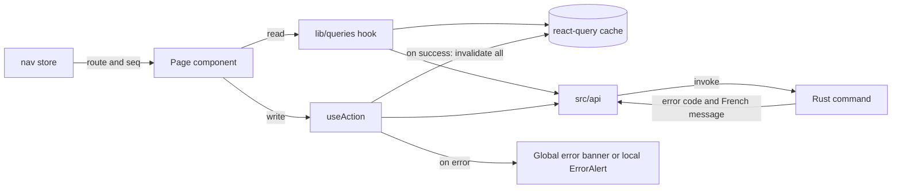

# Front end (`src/`)

The user interface of INVENTORY: a React 19 + TypeScript application, built by Vite and displayed by Tauri in a WebView2 window. It holds no business logic of its own beyond presentation: every read and write goes through the typed contract in `src/api/` to the Rust back end ([`../src-tauri/README.md`](../src-tauri/README.md)).

All user-visible text is in French, and so are most identifiers. The detailed front-end conventions are in [`../docs/socle-front.md`](../docs/socle-front.md) (French); the overall architecture is in [`../docs/ARCHITECTURE.md`](../docs/ARCHITECTURE.md#8-front-end-architecture).

## Structure

```
src/
  main.tsx          entry point: theme without flash, file-drop blocking, close listener, settings preload, render
  App.tsx           registry route -> page; theme and density follow the settings
  api/              typed contract with the back end (owned together with src-tauri)
    types.ts          every type exchanged with the Rust commands
    index.ts          the `api` object (68 functions, one per command), error normalisation, shared constants
  nav/              navigation without URLs
    routes.ts         the `Route` union (11 routes) and the six sidebar entries
    store.ts          zustand store: current route, history stack, seq; go / root / back / replace / update
    breadcrumb.ts     breadcrumb declared by each page
  shell/            application frame: TitleBar, Sidebar, TopBar, GlobalSearch (Ctrl+K), Shell
  pages/            one component per route, with helpers in sub-folders
    blocs/            rendering of template and document blocks ("paper"), block logic, autosave
    dossier/          open dossier: add dialog, document view, checklist, document deletion, preview, tree
    dossiers/         dossiers and archives: tree view, deletion, view state
    fiche/            employee or machine record: assignments, search in the profile, deletion
    parametres/       settings: dossier statuses
    repertoire/       employees and machines lists: filters
    studio/           template studio: block editor, drag-and-drop editor
    categories/       inline creation of the first category
  ui/               shared components: Modal, ConfirmModal, Table, Tabs, Timeline, Alert, Badge, QueryView, LimiteErreur…
  lib/              hooks and pure logic: queries, queryKeys, queryClient, action, errors, format, fermeture, depot, borne…
  styles/           CSS taken from the HTML prototype: tokens, base, components, print, later additions (v11 to v17)
```

Unit tests sit next to the code they test (`*.test.ts`, 23 files).

## Key concepts



- **Routes and pages.** A route is a typed object (`{ name: 'fiche', id: 12 }`). `App.tsx` maps each route name to a page, mounted with `key={seq}` so that every navigation starts the page with fresh local state. `nav.go` pushes the current page on the history stack, `nav.root` clears it (sidebar), `nav.back` pops it (Back button, Alt+Left), `nav.replace` swaps the current page, `nav.update` changes parameters without remounting.
- **Reading data.** One hook per read of the contract in `lib/queries.ts` (`useFiche(id)`, `useDossiers()`…); query keys are all defined in `lib/queryKeys.ts`. `<QueryView>` renders loading and error states.
- **Writing data.** Every write uses `useAction(fn, options)`. After success it invalidates the whole cache by default; only the queries on screen are re-read. Frequent writes may narrow the invalidation; the autosave of document blocks uses `'none'` so the editor is not re-read while typing.
- **Errors.** The back end rejects with `{ code, message }`, the message being a French sentence. By default a failed action shows it in a banner at the top of the page; `errors: 'local'` lets a form show it next to its fields. `LimiteErreur` catches rendering errors per page and keeps the frame usable.
- **Autosave.** Document editors save about 400 ms after the last change (`pages/blocs/autosave.ts`). `flushAll()` sends pending values immediately; it runs before status changes, renames and deletions, and when the window closes.
- **Closing the window.** The Rust side emits `fermeture-demandee`; `main.tsx` then flushes pending saves (at most 3 s) and destroys the window. If the interface does not answer, Rust destroys the window after 3.5 s.
- **Styles and the CSP.** The CSS and the screen layouts come from [`../design/prototype-entites-dossiers.html`](../design/prototype-entites-dossiers.html), the original static HTML prototype the application was built from. The production Content Security Policy has no `'unsafe-inline'` for styles or scripts: no `<style>` element or `style` attribute in markup, no inline script. Styles live in `src/styles/*.css`; colours chosen by the user (dossier statuses) are CSS classes from a closed palette. Forms must call `preventDefault()` in `onSubmit`, because the CSP forbids form submission (`form-action 'none'`). The end-to-end suite fails on any CSP violation.
- **Disabled, not hidden.** An action that is not allowed (closing a dossier with a missing document, deleting a used category) stays visible with `aria-disabled` and an explanation.
- **Window controls.** The window has no native frame; `shell/TitleBar.tsx` is the real title bar (drag region, minimise, maximise/restore, close). The interface is only granted these window permissions and event listening; it cannot access files directly.

## Running and verifying

From the repository root:

```powershell
npm ci                  # install dependencies
npm run tauri dev       # full application with hot reload (Vite on http://localhost:1420)
npx tsc --noEmit        # type-check (strict mode, no unused locals or parameters)
npx vitest run          # unit tests
npm run build           # tsc + vite build into dist/
```

`npm run dev` starts Vite alone; the page then opens in a browser without the Rust back end, so data calls fail. Use `npm run tauri dev` for real work.

## Adding a page or a call

1. Add the route to the `Route` union in `nav/routes.ts` and, if needed, its sidebar module in `defaultModule`.
2. Add the page component in `pages/` and its case in `renderPage` in `App.tsx`.
3. If the page needs a new back-end call, the contract changes first: the type in `api/types.ts`, the function in `api/index.ts` and the Rust command (see [`../src-tauri/README.md`](../src-tauri/README.md)). Then add a hook in `lib/queries.ts` (reads, with a key in `lib/queryKeys.ts`) or call it through `useAction` (writes).
4. Use the components of `ui/` and the existing CSS classes; write labels in French.
5. Add unit tests for any non-trivial logic placed in `lib/` or a page helper.

## See also

- [`../docs/socle-front.md`](../docs/socle-front.md): conventions in detail (French)
- [`../docs/specification.md`](../docs/specification.md): screens and the contract (French)
- [`../tests/README.md`](../tests/README.md): end-to-end tests of the real application
