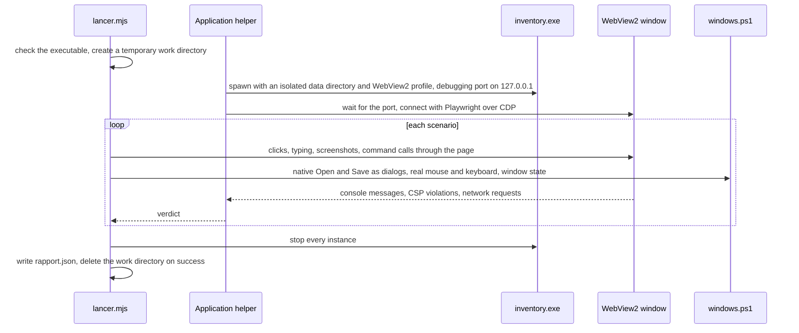
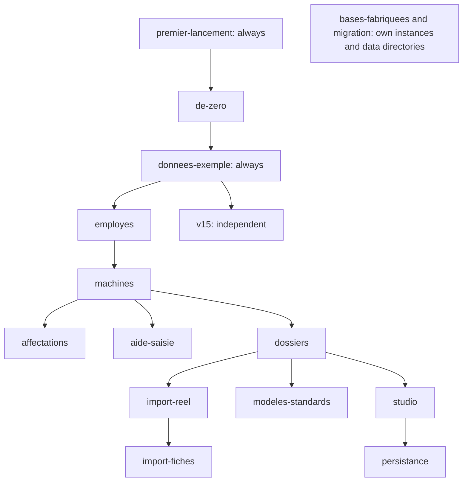

# Tests (`tests/`)

This folder holds the tests that need the real application or real Windows components:

| Folder | Content | Command |
| --- | --- | --- |
| `e2e/` | end-to-end suite on the production executable | `npm run e2e`, `npm run e2e:build` |
| `e2e/captures.mjs` | documentation screenshots (`docs/images/*.png`) | `npm run captures` |
| `installateur/` | test of the installer's pre-install hook | `npm run test:installateur` |

Rust tests live next to the code in `src-tauri/src`, front-end unit tests next to the code in `src` (`*.test.ts`).

## End-to-end suite (`e2e/`)

The end-to-end suite tests INVENTORY as a user sees it: it starts the **real production executable** (`inventory.exe`, built exactly like the delivered one), drives its WebView2 window through the Chrome DevTools Protocol with Playwright Core, and operates native Windows dialogs with the real mouse and keyboard. It complements the Rust tests (`cargo test` in `src-tauri`) and the front-end unit tests (`npx vitest run`), described in [`../docs/ARCHITECTURE.md`](../docs/ARCHITECTURE.md#11-testing-strategy).

Scenario names, step messages and the report are in French, like the application.

## Before you start

**Read this first: the suite takes control of the mouse and keyboard.**

- Windows 11 with an open, visible, unlocked session. Do not touch the mouse or keyboard while the suite runs; before each gesture it checks that the target window is in the foreground and stops otherwise.
- Close INVENTORY. The application is single-instance: if you opened it during the run, it would attach to the test instance and what you typed would go to the temporary test data, deleted at the end.
- Run the suite only on a machine where you are the only signed-in user. During the run the WebView2 debugging port is open on `127.0.0.1` without authentication: another account on the same machine could drive the test instance.
- Node.js 22 or newer with the built-in `node:sqlite` module (used to fabricate and read databases), and the project dependencies (`npm ci`).
- A production executable built by `npm run e2e:build` or `npm run livrer`. The suite refuses an executable older than the sources or one that fails the delivery checks (build-machine paths, Control Flow Guard, ASLR, DEP).

## Running

```powershell
npm run e2e:build                                  # build the release executable (no installer), then run the suite
npm run e2e                                        # run the suite on src-tauri\target\release\inventory.exe
npm run e2e -- --seulement employes,machines       # run only these scenarios (plus the two that always run)
npm run e2e -- --garder                            # keep the temporary data directory even on success
npm run e2e -- --exe "C:\path\to\inventory.exe"    # test another executable, e.g. the installed one
npm run e2e -- --sortie <folder>                   # write rapport.json (and, by default, screenshots) elsewhere
npm run e2e -- --captures <folder>                 # write screenshots elsewhere
npm run e2e -- --sans-base-reelle                  # skip the scenario that works on a copy of your real database
```

| Option | Effect |
| --- | --- |
| `--seulement a,b` | runs only the listed scenario ids; `premier-lancement` and `donnees-exemple` always run. Dependencies are **not** added automatically (see below) |
| `--garder` | keeps the temporary work directory (it is also kept when a scenario fails) |
| `--exe <path>` | uses another executable; the freshness and delivery checks are skipped |
| `--sortie <folder>` | output folder for `rapport.json`; default `tests/e2e/resultats/` |
| `--captures <folder>` | screenshots folder; default `<sortie>/captures/` |
| `--sans-base-reelle` | the `migration` scenario is reported as not played |

The process exit code is 0 when no scenario failed, 1 when at least one failed, 2 when the suite could not start.

## What the suite does on the machine



- A work directory `entites-dossiers-e2e-*` is created in the system temporary folder. The application is started with `ENTITES_DOSSIERS_DONNEES` pointing to its `donnees` subfolder, `WEBVIEW2_USER_DATA_FOLDER` pointing to an isolated profile, and `WEBVIEW2_ADDITIONAL_BROWSER_ARGUMENTS` opening a remote debugging port on a free local port. Your real data directory (`%APPDATA%\fr.entitesdossiers.app`) is never written.
- The only scenario that reads your real data is `migration`: it **copies** the real data directory into the work directory and runs the application on the copy, never on the original. Use `--sans-base-reelle` to skip it.
- `outils/windows.ps1` is a small PowerShell server that uses UI Automation and Win32 input to bring windows to the foreground, fill in and confirm native file dialogs, close native message boxes, and perform real drag and drop in the template studio. It acts only if the target window is in the foreground.
- The real print dialog is not driven; the print sheet is checked by emulating the `print` media.
- The report `rapport.json` and screenshots go to `tests/e2e/resultats/` (not versioned). A failing scenario also saves a screenshot under `captures/echecs/`.

**Verdict rules.** Besides its own assertions, a scenario fails if, while it runs, the console shows an error or a warning, a page exception is raised, a CSP violation is reported, or a request goes anywhere other than the application's own hosts (`tauri.localhost`, `ipc.localhost`, `asset.localhost`). Known limits observed by a scenario are printed with the verdict without failing it.

## Scenarios

Scenarios run in the order of `scenarios/index.mjs`, on the same data directory, each building on the state left by the previous ones. There are 35.



The arrows show the main data dependencies, passed through `ctx.memo` (for example `studio` needs the dossier created by `dossiers`, which needs the records of `employes` and `machines`). There are more: several later scenarios reuse the records, dossier, imported files or studio document created earlier (for example `classement-magasin` reads the document created by `studio`). Apart from the two scenarios that always run, only `v15`, `bases-fabriquees` and `migration` are independent of the scenarios before them. When you use `--seulement`, list the prerequisites too, or run the whole suite; many scenarios check their prerequisites and fail with a message naming the scenario they need.

| Id | What it checks |
| --- | --- |
| `premier-lancement` | a new database is empty apart from the four standard templates: empty screens, no example-data badge |
| `de-zero` | starting from nothing: first structure and employee, first machine type and machine, first dossier, one document per standard template, restart |
| `donnees-exemple` | example data loaded from Settings, consistent dashboard and title bar |
| `employes` | live identifier, homonym, record to complete then completed, edit, archive |
| `machines` | typed identifier, duplicate refused, characteristics, inventory, edit |
| `affectations` | assign without a dossier, end, reassign, end despite a dossier; clickable history |
| `aide-saisie` | suggestions with keyboard and mouse, homonyms, archived records excluded |
| `dossiers` | create, sub-folder, documents, typing, final document, closing, checklist |
| `rattachement` | dossiers are no longer attached to an employee or machine anywhere in the interface |
| `etats` | status list, closing refused with a missing document, user statuses and colours, filters, dashboard, search, rename, delete, restart |
| `dossier-libre` | mandatory fields, variables following the document's blocks, mentions on profiles and in history |
| `nominations` | mentions by block, written name and written identifier, removal, stable dates across restarts, history links |
| `import-reel` | import through the native file dialog (PNG, PDF), cancel, copy, preview, deletion |
| `import-fiches` | employee and machine of an imported file, on their profiles, read-only in a closed dossier |
| `modeles-standards` | one filled document per standard template, on screen and printed, read back after restart |
| `studio` | custom fields, settings, reordering by drag and drop, snapshot, duplicate, archive, restore |
| `champs-obligatoires` | star, notice, empty submission refused and focus on every form |
| `suppression-modele` | template deletion refused with its reason or accepted; standard template deleted then restored |
| `recherche-profil` | search and filters in a profile's documents and history tabs |
| `filtres-navigation` | filters and sorting of lists, tabs and breadcrumb |
| `classement-magasin` | categories, structures, types and keywords: add, archive, reactivate |
| `structures-types` | rename, record counts, deletion refused with reason or accepted, duplicate refused |
| `recherche-raccourcis` | global search, Ctrl+K, arrows, Enter, Escape, Alt+Left |
| `recherche-longue` | more than 4 results, scrolling list, 50 of 68 |
| `impression` | print button, print sheet limited to the document paper |
| `ecrans` | every screen in light and dark themes: clean console, layout at 1280 x 800 and 1024 x 640, vocabulary, screenshots |
| `parametres-affichage` | theme and density applied and saved |
| `persistance` | close and restart: data, last edit, theme and density kept |
| `fenetre` | maximise, restore, double click, minimise, single instance |
| `parametres-donnees` | system information, erase all data, reload example data, backups |
| `securite` | booby-trapped content, preview by content, forbidden types, export, capabilities refused to the page, navigation, file drop, CSP, closing with a frozen interface |
| `fermeture` | closing ends the process |
| `v15` | direct deletion of documents, employees and machines, with its confirmations and effects, across a restart |
| `bases-fabriquees` | fabricated databases at every schema version: tampered ones refused without modification, files kept, large volumes rendered in bounded slices |
| `migration` | a copy of the real database is backed up and migrated to version 6 with nothing lost; the original is untouched |

## Layout

```
tests/installateur/
  crochet-preinstall.mjs  installer hook test runner
  essai-crochet.nsi       small NSIS script that embeds the hook for the test
tests/e2e/
  lancer.mjs          runner: arguments, checks, work directory, scenario loop, verdicts, report
  captures.mjs        documentation screenshots
  scenarios/
    index.mjs         ordered list of scenarios
    *.mjs             scenarios, grouped by area or by version
  outils/
    application.mjs   start, connect, call commands, observe console and network, stop
    windows.mjs       Node side of the Windows automation server
    windows.ps1       Windows automation: windows, native dialogs, real mouse and keyboard
    ui.mjs            common gestures: sidebar, buttons, dialogs, records, documents
    verifs.mjs        assertions (egal, verifier, attendre) and the Echec error
    bases.mjs         fabrication and reading of SQLite databases with node:sqlite
    fichiers.mjs      test input files
```

## Writing a scenario

A scenario is an object exported from a file in `scenarios/` and added to the list in `scenarios/index.mjs`:

```js
export const monScenario = {
  id: 'mon-scenario',               // used by --seulement
  titre: 'Ce que le scénario vérifie',
  // toujours: true,                // run even with --seulement
  // sansApplication: true,         // the scenario starts its own instances (ctx.autreApplication)
  // indisponible(ctx, args) { … }, // return a reason to report the scenario as not played
  async executer(ctx) {
    const { page, app } = ctx;      // Playwright page and Application helper
    ctx.etape('what is being checked');
    const dossiers = await app.appeler('dossiers_lister');   // call a back-end command through the page
    // drive the interface with page.locator(…) and the helpers of outils/ui.mjs
    // assert with egal / verifier / attendre from outils/verifs.mjs
    await ctx.capture('dossier/mon-scenario');
  },
};
```

Guidelines:

- Interact through the interface as a user would; use `app.appeler` to prepare data or to read the resulting state back from the back end.
- Share data with later scenarios through `ctx.memo`, and check at the start that what you need is there, with a message naming the scenario that provides it.
- Use `ctx.lancer()` to restart the application on the same data directory, and `ctx.autreApplication(nom)` for an instance on a separate data directory.
- Native dialogs and real input go through `outils/windows.mjs`; never send keystrokes without checking the foreground window.
- A scenario must leave the console clean: any error or warning fails it.

## Documentation screenshots

`npm run captures` (or `node tests/e2e/captures.mjs --exe <path>`) starts the production executable on a temporary data directory, loads the fictitious example data, sets the light theme and a 1280 x 800 viewport, and writes `docs/images/dashboard.png`, `employee.png`, `dossier.png`, `studio.png`, `archives.png` and `settings.png`. It drives the application through the WebView2 debugging port like the end-to-end suite, so the same precautions apply: close INVENTORY first, and run it on a machine where you are the only signed-in user. A screenshot is refused if an error alert or a dialog is visible.

## Installer hook test (`installateur/`)

`npm run test:installateur` checks the NSIS pre-install hook (`src-tauri/windows/hooks.nsh`), which removes a former "Entités et Dossiers" installation. It compiles the hook into a small test installer (`essai-crochet.nsi`) with `makensis`, taken from Tauri's cache (`%LOCALAPPDATA%\tauri\NSIS`) or from the `PATH`, under a test-specific product name. It then registers fake former installations in temporary folders under a test key in `HKCU\Software\Microsoft\Windows\CurrentVersion\Uninstall\`, runs the installer silently for each registered value (a valid folder, a folder emptied by the removal, a folder deduced from `UninstallString`, and refused values: no old executable, relative path, `.` or `..` components, `\\?\` path, network path, alternate data stream), and checks that only the two named files are deleted in the valid cases, that nothing is deleted in the refused ones, and that the old registration is removed in every case. All temporary folders and registry keys are removed at the end. The environment variable `ESSAI_CROCHETS` can point to another version of the hook file, for comparison. The test runs on Windows only and is not part of CI.

## See also

- [`../docs/ARCHITECTURE.md`](../docs/ARCHITECTURE.md#11-testing-strategy): testing strategy
- [`../scripts/README.md`](../scripts/README.md): how the tested executable is built
- [`../SECURITY.md`](../SECURITY.md): security policy
